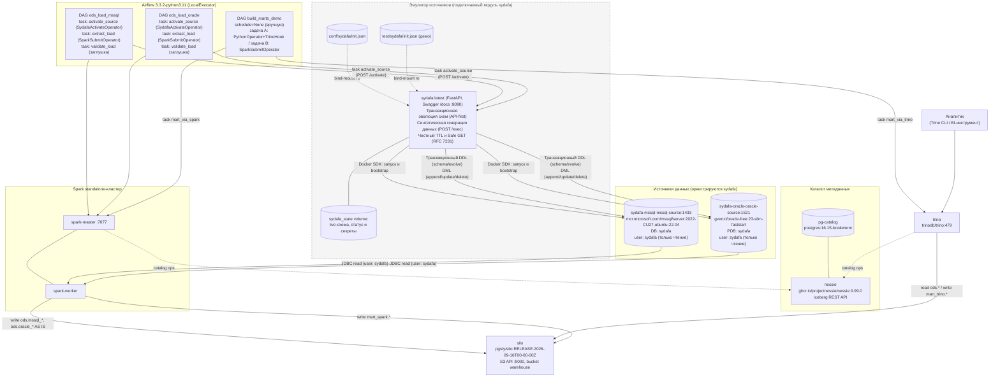

# datalake_stand — PoC стенда КХД → DLH

Локальный docker-compose стенд: загрузка данных из реальных реляционных
источников (MSSQL, Oracle) в ODS-слой Iceberg **AS IS**, и демонстрация
двух способов трансформации данных внутри DataLake (Trino SQL и Spark).

## Структура директорий стенда

| Путь | Назначение |
|---|---|
| `airflow/` | Пользовательские DAG-и (каркас удерживается `.gitkeep`). Содержит плагин `airflow/plugins/sydafa_plugin.py` (`SydafaActivateOperator`). |
| `spark/` | Пользовательские Spark-job-ы (каркас удерживается `.gitkeep`). Не коммитятся. |
| `trino/` | Пользовательский SQL (каркас удерживается `.gitkeep`). Не коммитятся. |
| `conf/airflow` | Dockerfile, requirements, пароли UI |
| `conf/spark` | Dockerfile, spark-defaults.conf |
| `conf/trino` | runtime-конфиг Trino (catalog, TLS, password.db) |
| `conf/silo` | `init-bucket.sh` |
| `conf/sydafa` | декларативный манифест `init.json` источников СУБД |
| `test/` | демо-DAG-и (`test/dags/`), spark-jobs, trino-sql, `test/sydafa/init.json`, `test.sh`, `run_flow.py`, `README.md`, override |
| `docker-compose.yaml` | каркас стенда без демо-наполнения |

Пользовательский код кладётся в `airflow/`, `spark/`, `trino/` на хосте — compose монтирует эти каталоги в контейнеры (а каталог `airflow/plugins` монтируется в `/opt/airflow/plugins:ro`). Демо поднимается только через `./test/test.sh` (override).

## Архитектура



## Состав стенда

**Контур A (релевантно production DLH-архитектуре):**

| Компонент           | Образ/версия                                                                                     |
| ------------------- | ------------------------------------------------------------------------------------------------ |
| sydafa-mssql-source | `mcr.microsoft.com/mssql/server:2022-CU27-ubuntu-22.04`                                          |
| sydafa-oracle-source| `gvenzl/oracle-free:23-slim-faststart`                                                           |
| pg-catalog          | `postgres:16.15-bookworm`                                                                        |
| nessie              | `ghcr.io/projectnessie/nessie:0.99.0`                                                           |
| silo                | `pgsty/silo:RELEASE.2026-09-16T00-00-00Z`                                                        |
| spark-master/worker | база `tabulario/spark-iceberg:3.5.5_1.8.1` + `mssql-jdbc:12.10.0.jre11` + `ojdbc11:23.8.0.25.04` |
| trino               | `trinodb/trino:479`                                                                              |
| airflow             | `apache/airflow:3.3.2-python3.11`, LocalExecutor                                                 |

<br />

**Контур B (эмуляция источников данных, подключаемый компонент):** `sydafa` —
автономный сервис (Docker-образ `sydafa:latest`), оркестрирующий контейнеры СУБД,
предоставляющий REST API для транзакционной эволюции схем и FK-aware генерации синтетических данных.
Конфигурация живого стенда: `conf/sydafa/init.json`. Демо (оба источника + тестовые таблицы) — `test/sydafa/init.json`, подключается override-ом теста.

## Быстрый старт

```bash
docker compose up -d --build
```

Порты:

| Сервис                       | Порт на хосте |
| ---------------------------- | ------------- |
| sydafa (Swagger UI :8090)    | 8090          |
| nessie                       | 19120         |
| silo (S3 API / консоль)      | 9000 / 9001   |
| spark-master UI              | 8080          |
| spark-worker UI              | 8081          |
| trino (HTTPS)                | 8443          |
| airflow webserver/api-server | 8089          |

## Доступ к сервисам

### Web-интерфейсы

| Сервис | URL | Логин/пароль |
|---|---|---|
| Spark Master UI | http://localhost:8080 | без авторизации |
| Spark Worker UI | http://localhost:8081 | без авторизации |
| SILO (консоль, MinIO-совместимая) | http://localhost:9001 | `admin` / `admin123` (`SILO_ROOT_USER`/`SILO_ROOT_PASSWORD`) |
| sydafa (Swagger UI) | http://localhost:8090/docs | без авторизации (эмулятор источников СУБД) |
| Airflow | http://localhost:8089 | `admin` / `admin` (`AIRFLOW_UI_USER`/`AIRFLOW_UI_PASSWORD`) |

### Подключение из DBeaver (на машине, где запущен docker)

**Trino** — драйвер «Trino» (встроен в DBeaver):
- Host: `localhost`, Port: `8443`
- Use SSL: да (Trino работает по HTTPS с самоподписанным сертификатом)
- Catalog/Database: `iceberg`
- Username: `admin`, Password: `admin`
  (password-authenticator — `conf/trino/`)
- Driver properties: `SSL=true;SSLVerification=NONE`
- JDBC URL: `jdbc:trino://localhost:8443/iceberg?SSL=true&SSLVerification=NONE`

**Источники MSSQL/Oracle** не имеют постоянного host-порта. Инспекция только на чтение через Swagger UI:

1. Откройте в браузере Swagger UI: `http://localhost:8090/docs`.
2. Выполните метод `POST /sources/{mssql|oracle}/activate?ttl_minutes=15` (нажмите "Try it out" -> "Execute").
3. Из ответа возьмите параметры подключения `connection` (хостовый порт `host_port` или готовую строку `jdbc_url`).
4. В DBeaver настройте подключение: Host `localhost`, Port = `host_port`, user `sydafa` / password `sydafa`:
   - MSSQL: Database `sydafa`, включите опцию `trustServerCertificate=true` (строка подключения: `jdbc:sqlserver://localhost:14330;databaseName=sydafa;trustServerCertificate=true;encrypt=false`);
   - Oracle: Service Name `sydafa` (строка подключения: `jdbc:oracle:thin:@//localhost:15211/sydafa`).
5. По истечении TTL контейнер аккуратно останавливается демоном sydafa. Внутренний DBA `_sydafa_admin_*` снаружи недоступен (случайный пароль в `/state/secrets.json`).

### Добавление источника на живом стенде

1. Описать новый источник в `conf/sydafa/init.json` (тип, схемы, таблицы, генераторы).
2. Задать при необходимости внешний порт в `docker-compose.yaml` (например `SYDAFA_EXT_PORT_CRM=15211`).
3. Перезапустить контейнер `sydafa`: `docker compose up -d sydafa`.
4. Первый `/exec` или `/activate` поднимет контейнер; `init.json` применится автоматически при чистом томе состояния.

## Работа со стендом

### Управление источниками и данными — sydafa

Сервис **sydafa** (Synthetic Data Factory & DB Orchestrator) вынесен в отдельный независимый репозиторий [georgekochergin/sydafa](https://github.com/georgekochergin/sydafa) и поставляется в виде Docker-образа (`ghcr.io/georgekochergin/sydafa:latest` или локальный `sydafa:latest`).

На данном стенде `sydafa` эмулирует реляционные источники данных:
- Лениво оркестрирует контейнеры СУБД `sydafa-mssql-source` / `sydafa-oracle-source` через Docker API (данные живут в named volume);
- Создаёт рабочую базу/PDB `sydafa` и читателя `sydafa` / `sydafa` (только чтение); пароль внутреннего администратора случайный и доступен только сервису;
- Внешний доступ для DBeaver: `SYDAFA_EXT_PORT_MSSQL=14330` в `docker-compose.yaml`;
- REST API: транзакционный DDL/DML через `POST /sources/{source}/exec` и lifecycle (`activate` / `deactivate` / `status`).

Конфиг живого стенда: `conf/sydafa/init.json`. Демо-init: `test/sydafa/init.json`.

REST-интерфейс: `http://localhost:8090`, интерактивная документация: `http://localhost:8090/docs`.

#### Основные эндпоинты

| Метод | Путь | Назначение |
| --- | --- | --- |
| GET | `/health` | Готовность API sydafa |
| GET | `/sources` | Список зарегистрированных источников |
| POST | `/sources` | Динамическая регистрация нового инстанса `{"name": "...", "type": "..."}` |
| DELETE | `/sources/{source}` | Удаление инстанса СУБД и контейнера |
| GET | `/sources/{source}` | Метаданные источника, статус reader, объект connection и плоский список таблиц (Safe GET, не будит базу) |
| GET | `/sources/{source}/schema` | Детальная live-схема источника: таблицы, колонки, типы, генераторы, PK/FK (Safe GET) |
| GET | `/sources/{source}/status` | Состояние контейнера (idle/running), TTL, реквизиты `connection` (Safe GET) |
| POST | `/sources/{source}/activate` | Физический запуск СУБД в Docker и установка TTL (`?ttl_minutes=15`) |
| POST | `/sources/{source}/deactivate` | Принудительная остановка контейнера для освобождения RAM |
| POST | `/sources/{source}/exec` | Единый транзакционный метод DDL + DML (All-or-Nothing). Будит базу при необходимости |

#### Документация и спецификация API sydafa

Вся детальная документация, правила интеграции и спецификации вынесены в репозиторий проекта:
- 📖 [Руководство по sydafa](https://github.com/georgekochergin/sydafa);
- 🔄 Спецификация транзакционного метода `POST /sources/{source}/exec` (DDL + DML);
- 🧬 Семантика генераторов синтетических данных (`sequence`, `faker`, `choice`, `random_decimal`, `random_date`).

---

### Сценарий подключения к внешней sydafa (раздельный контур)

Если сервис `sydafa` развернут на отдельном сервере или в отдельном независимом Compose-проекте, стенд КХД настраивается следующим образом:
1. В `docker-compose.yaml` стенда сервис `sydafa` отключается (комментируется блок `sydafa:`).
2. В файле `.env` (или переменных сервисов Spark/Airflow) задаются внешние адреса:
   ```bash
   SYDAFA_URL=http://<IP_ИЛИ_HOST_SYDAFA>:8090
   MSSQL_HOST=<IP_ИЛИ_HOST_SYDAFA>
   MSSQL_PORT=14330
   ORACLE_HOST=<IP_ИЛИ_HOST_SYDAFA>
   ORACLE_PORT=15210
   ```
3. Если оба Compose работают на одном локальном компьютере, в качестве хоста используется `host.docker.internal` (с директивой `extra_hosts: ["host.docker.internal:host-gateway"]`). Spark и Airflow подключаются под пользователем `sydafa` / `sydafa`.

---

### Обновление ODS-слоя Iceberg

Отдельные DAG-и в Airflow (расписание `schedule=None` — запуск вручную):

- `ods_load_mssql`:
  1. Таск `activate_source` (`SydafaActivateOperator` из `airflow/plugins/sydafa_plugin.py`) отправляет `POST /sources/mssql/activate?ttl_minutes=15`, гарантируя физический запуск контейнера в Docker;
  2. Таск `extract_load` (`SparkSubmitOperator`) запускает `test/spark-jobs/load_ods_mssql.py`: читает `demo.*` по JDBC под учеткой `sydafa`/`sydafa` через внутреннюю Docker-сеть (`sydafa-mssql-mssql-source:1433`) и перезаписывает (AS IS) таблицы `iceberg.ods.mssql_customers`, `mssql_orders`, `mssql_products`;
  3. Таск `validate_load` (`PythonOperator`): заглушка валидации.
- `ods_load_oracle`:
  1. Таск `activate_source` (`SydafaActivateOperator`) пробуждает `oracle` через `POST /sources/oracle/activate?ttl_minutes=15`;
  2. Таск `extract_load` (`SparkSubmitOperator`) запускает `test/spark-jobs/load_ods_oracle.py`: читает `demo.*` по JDBC через `sydafa-oracle-oracle-source:1521` и перезаписывает (AS IS) `iceberg.ods.oracle_customers`, `oracle_orders`, `oracle_products`;
  3. Таск `validate_load` (`PythonOperator`): заглушка валидации.

Демо-DAG-и изолированы в `test/dags/` и подключаются override-ом теста. Запуск — Airflow UI → DAGs → unpause & ▶, либо CLI:

```bash
docker compose exec -T airflow-scheduler airflow dags unpause ods_load_mssql
docker compose exec -T airflow-scheduler airflow dags trigger ods_load_mssql
docker compose exec -T airflow-scheduler airflow dags unpause ods_load_oracle
docker compose exec -T airflow-scheduler airflow dags trigger ods_load_oracle
```

Проверка результата (Trino): `SELECT count(*) FROM iceberg.ods.mssql_orders;`

### Обновление детального (mart) слоя

DAG `build_marts_demo` (вручную, `schedule=None`) — две независимые задачи:

- `mart_via_trino` → `trino/sql/build_mart_trino_demo.sql`: создаёт `iceberg.mart_trino.customer_totals` (`customer_id`, `orders_count`, `total_amount`) из `iceberg.ods.mssql_orders`;
- `mart_via_spark` → `test/spark-jobs/build_mart_spark_demo.py`: создаёт `iceberg.mart_spark.customer_totals` (`customer_id`, `orders_count`, `total_amount`) из `iceberg.ods.mssql_orders`.

Запуск:

```bash
docker compose exec -T airflow-scheduler airflow dags trigger build_marts_demo
```

Результат — таблицы `iceberg.mart_trino.customer_totals` и `iceberg.mart_spark.customer_totals` (читаются из Trino).

## Тестирование стенда

Подробная документация по сценариям тестирования, изолированному контуру и обработке краевых случаев приведена в [test/README.md](test/README.md).

Стенд поддерживает два режима тестирования:
1. **Полный сквозной прогон e2e** (в изолированном compose-проекте `dlh-test`):
   ```bash
   ./test/test.sh
   ```
   Скрипт полностью изолирован от продуктивного стенда:
   - Поднимает стек с оверрайдом `test/docker-compose.override.yaml`;
   - В отдельном контейнере `test-runner` исполняет сценарий `test/run_flow.py`;
   - Проверяет readiness всех компонентов, интроспекцию Safe GET, валидацию SQL-инъекций (HTTP 422);
   - Генерирует данные в sydafa, запускает DAG-и с `SydafaActivateOperator`, выгружает ODS Spark-джобами в Iceberg, строит витрины в Trino и Spark, и сверяет контрольные суммы;
   - По завершении автоматически удаляет тестовые контейнеры и тома.

2. **Быстрая проверка компонентов на уже работающем стенде** (smoke-тесты за 5 секунд):
   ```bash
   ./test/test.sh --verify
   ```

Критерий успешности: финальная строка `PASS=… FAIL=0`, exit-code 0. При ошибках — см. `test/troubleshooting.md`.

Предусловия: Docker + Docker Compose, склонированный репозиторий, `.env`
(уже закоммичен). Интернет нужен только для первого `build` образов — повторные
запуски работают офлайн.

Для разработки (стенд остаётся поднятым) — обычный `docker compose up -d --build`.

## Учётные данные

Тестовый стенд — везде, где логин/пароль настраиваемы, используется
`admin` / `admin` (см. `.env`). Исключение по имени — системный
bootstrap-логин MSSQL `sa`: имя фиксировано образом, а пароль не может быть
буквально `admin` (MSSQL требует длину ≥8 и минимум 3 из 4 категорий символов),
поэтому у `sa` остаётся сильный пароль `AdminPassword1!`, после первичного bootstrap системный `sa` отключается (`DISABLE`), а для чтения создаётся публичная учетная запись `sydafa`/`sydafa` (только `SELECT`). Внутренний администратор базы `_sydafa_admin_*` генерирует случайный пароль, сохраняемый только в `/state/secrets.json`.
SILO (консоль `:9001`) — `admin`/`admin123` (MinIO требует пароль ≥8 символов,
поэтому буквально `admin` невозможен), pg-catalog, airflow-postgres,
Airflow UI (`:8089`), Trino (`:8443`) — везде `admin`/`admin`. У Oracle системные SYS/SYSTEM и pdbadmin блокируются/удаляются, читатель — `sydafa` / `sydafa`.
