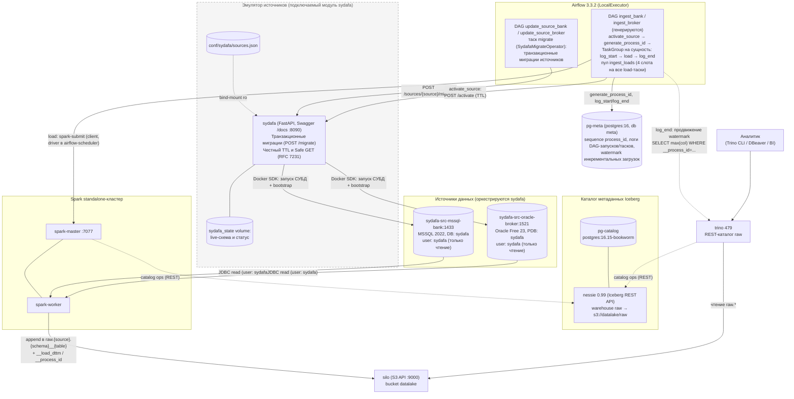

# datalake_stand — PoC стенда КХД → DLH

Локальный docker-compose стенд: загрузка данных из реляционных источников
(MSSQL, Oracle) в **raw-слой** Iceberg **AS IS** — точное зеркало таблиц
источника плюс технические колонки, без бизнес-логики и преобразований.
Обрабатывающие слои (ods/dds/dma) строятся поверх raw и в текущей версии
вне рамок; raw при их появлении не меняется. Работа с данными — Trino SQL
и Spark.

## Структура директорий стенда

| Путь | Назначение |
|---|---|
| `airflow/` | DAG-и обновления источников (`update_source_*`), сгенерированные DAG-и загрузки raw-слоя (`dags/generated/`); плагины: `plugins/ingestion` (операторы + реестр pg-meta), `plugins/migrations` (операции миграций). Интеграция с sydafa через пакет `sydafa-airflow`. |
| `spark/` | Spark-job-ы по слоям: `spark/raw/load_entity.py` — append-only загрузчик одной сущности (JDBC → Iceberg). |
| `trino/` | Пользовательский SQL (каркас удерживается `.gitkeep`). |
| `ingestion/` | Манифесты источников (`sources.yaml`) и пайплайнов (`pipelines/*.yaml`), библиотека валидации (`lib/`), генератор DAG-ов (`generate_dags.py`). |
| `conf/airflow` | Dockerfile, requirements, пароли UI |
| `conf/spark` | Dockerfile, spark-defaults.conf (каталог `raw`) |
| `conf/trino` | runtime-конфиг Trino (catalog `raw`, TLS, password.db) |
| `conf/silo` | `init-bucket.sh` (создаёт bucket `datalake`) |
| `conf/pg-meta` | init-SQL операционной БД пайплайнов загрузки (применяется при первом старте контейнера) |
| `conf/sydafa` | декларативный манифест `sources.json` источников СУБД |
| `test/` | e2e-сценарий (`run_flow.py`, `test.sh`, override) и юнит-тесты (`unit/`) |
| `docker-compose.yaml` | каркас стенда |

Пользовательский код кладётся в `airflow/`, `spark/`, `trino/` на хосте — compose монтирует эти каталоги в контейнеры (а каталог `airflow/plugins` монтируется в `/opt/airflow/plugins:ro`).

## Архитектура



## Состав стенда

**Контур A (релевантно production DLH-архитектуре):**

| Компонент           | Образ/версия                                                                                     |
| ------------------- | ------------------------------------------------------------------------------------------------ |
| sydafa-mssql-source | `mcr.microsoft.com/mssql/server:2022-CU27-ubuntu-22.04`                                          |
| sydafa-oracle-source| `gvenzl/oracle-free:23-slim-faststart`                                                           |
| pg-catalog          | `postgres:16.15-bookworm`                                                                        |
| pg-meta             | `postgres:16.15-bookworm` (операционная БД пайплайнов загрузки)                                      |
| nessie              | `ghcr.io/projectnessie/nessie:0.99.0`                                                            |
| silo                | `pgsty/silo:RELEASE.2026-09-16T00-00-00Z` (bucket `datalake`)                                    |
| spark-master/worker | база `tabulario/spark-iceberg:3.5.5_1.8.1` + `mssql-jdbc:12.10.0.jre11` + `ojdbc11:23.8.0.25.04` |
| trino               | `trinodb/trino:479`                                                                              |
| airflow             | `apache/airflow:3.3.2-python3.11`, LocalExecutor                                                 |

<br />

**Контур B (эмуляция источников данных, подключаемый компонент):** `sydafa` —
автономный сервис (Docker-образ `sydafa:latest`), оркестрирующий контейнеры СУБД,
предоставляющий REST API для транзакционной эволюции схем и FK-aware генерации синтетических данных.
Конфигурация источников: `conf/sydafa/sources.json` (тестовый контур использует его копию
из рабочей копии репозитория — `test.sh` собирает изолированное дерево в `test/.workspace/`).

## Быстрый старт

### Требования к ресурсам Docker

Стенду нужен Docker-хост (для Docker Desktop — виртуальная машина Docker)
с **минимум 16 ГБ RAM**. Одновременно работают две СУБД-источника (MSSQL + Oracle),
кластер Spark, Airflow, Trino, Nessie, silo и три инстанса PostgreSQL, а при
параллельных загрузках — несколько Spark-приложений разом. Дефолтных для
Docker Desktop 8 ГБ не хватает: OOM-killer останавливает контейнеры СУБД-источников
и Trino прямо посреди загрузки (симптом — падение load-тасков по JDBC-коннекту).

Проверка выделенной памяти:

```bash
docker info | grep "Total Memory"   # должно быть ≥ 16 GiB
```

В Docker Desktop память меняется в Settings → Resources → Memory
(изменение требует рестарта Docker).

### Запуск

```bash
docker compose up -d --build
```

Порты:

| Сервис                       | Порт на хосте |
| ---------------------------- | ------------- |
| sydafa (Swagger UI :8090)    | 8090          |
| nessie                       | 19120         |
| silo (S3 API / консоль)      | 9000 / 9001   |
| spark-master UI              | 8080          |
| spark-worker UI              | 8081          |
| trino (HTTPS)                | 8443          |
| airflow webserver/api-server | 8089          |

## Доступ к сервисам

### Web-интерфейсы

| Сервис | URL | Логин/пароль |
|---|---|---|
| Spark Master UI | http://localhost:8080 | без авторизации |
| Spark Worker UI | http://localhost:8081 | без авторизации |
| SILO (консоль, MinIO-совместимая) | http://localhost:9001 | `admin123` / `admin123` (`STAND_USER`/`STAND_PASSWORD`) |
| sydafa (Swagger UI) | http://localhost:8090/docs | без авторизации (эмулятор источников СУБД) |
| Airflow | http://localhost:8089 | `admin123` / `admin123` (`STAND_USER`/`STAND_PASSWORD`) |

### Подключение из DBeaver (на машине, где запущен docker)

**Trino** — драйвер «Trino» (встроен в DBeaver):
- Host: `localhost`, Port: `8443`
- Use SSL: да (Trino работает по HTTPS с самоподписанным сертификатом)
- Catalog/Database: `raw`
- Username: `admin123`, Password: `admin123`
  (password-authenticator — `conf/trino/`)
- Driver properties: `SSL=true;SSLVerification=NONE`
- JDBC URL: `jdbc:trino://localhost:8443/raw?SSL=true&SSLVerification=NONE`

Примеры запросов к raw-слою (текущее состояние таблицы и одна порция загрузки):

```sql
SELECT * FROM raw.bank.retail_bank__clients
WHERE __load_dttm = (SELECT max(__load_dttm) FROM raw.bank.retail_bank__clients);

SELECT count(*) FROM raw.bank.retail_bank__transactions WHERE __process_id = 42;
```

**Источники, управляемые sydafa**:

1. Откройте в браузере Swagger UI: `http://localhost:8090/docs`.
2. Выполните метод `POST /sources/{bank|broker}/activate?ttl_minutes=15` (нажмите "Try it out" -> "Execute").
3. Из ответа возьмите параметры подключения `connection`.
4. По истечении `ttl_minutes` контейнер аккуратно останавливается демоном sydafa.

### Добавление источника на живом стенде

Манифест `sources.json` является **декларативным источником правды** для топологии баз и начального наполнения.

1. **Добавление нового источника**:
   Откройте `conf/sydafa/sources.json` и добавьте описание нового инстанса с внешним портом:
   ```json
   "crm": {
     "type": "oracle",
     "external_port": 15211,
     "operations": []
   }
   ```
2. **Перезапуск контейнера sydafa**:
   ```bash
   docker compose restart sydafa
   ```
   Sydafa выполнит первичное наполнение нового источника (если заданы `operations`), после чего сразу остановит СУБД для экономии памяти (0 MB RAM). Ранее инициализированные базы не затрагиваются.
3. **Создание схем, таблиц и наполнение данными через API**:
   Отправьте транзакционный батч операций через `POST /sources/{name}/migrate` (или через Swagger UI: `http://localhost:8090/docs`).

> **Сброс к sources.json**: если требуется пересоздать базы с нуля строго по файлу `conf/sydafa/sources.json`, выполните сброс томов Compose: `docker compose down -v`.

## Работа со стендом

### Управление источниками и данными — sydafa

Сервис **sydafa** (Synthetic Data Factory & DB Orchestrator) вынесен в отдельный независимый репозиторий [georgekochergin/sydafa](https://github.com/georgekochergin/sydafa) и поставляется в виде Docker-образа (`ghcr.io/georgekochergin/sydafa:latest` или локальный `sydafa:latest`).

На данном стенде `sydafa` эмулирует реляционные источники данных:
- Лениво оркестрирует контейнеры СУБД `sydafa-src-mssql-bank` / `sydafa-src-oracle-broker` через Docker API (данные живут в named volume);
- Создаёт рабочую базу/PDB `sydafa` и читателя `sydafa` / `sydafa` (только чтение); админский доступ извне заблокирован;
- Внешний доступ для DBeaver: порт `14330` задан в манифесте `sources.json`;
- REST API: транзакционный DDL/DML через `POST /sources/{source}/migrate` и lifecycle (`activate` / `deactivate` / `status`).

Конфиг источников стенда: `conf/sydafa/sources.json`.

REST-интерфейс: `http://localhost:8090`, интерактивная документация: `http://localhost:8090/docs`.

#### Основные эндпоинты

| Метод | Путь | Назначение |
| --- | --- | --- |
| GET | `/health` | Готовность API sydafa |
| GET | `/sources` | Список зарегистрированных источников из sources.json |
| GET | `/sources/{source}` | Метаданные источника, статус reader, объект connection и плоский список таблиц (Safe GET, не будит базу) |
| GET | `/sources/{source}/schema` | Детальная live-схема источника: таблицы, колонки, типы, генераторы, PK/FK (Safe GET) |
| GET | `/sources/{source}/status` | Состояние контейнера (idle/running), TTL, реквизиты `connection` (Safe GET) |
| POST | `/sources/{source}/activate` | Физический запуск СУБД в Docker и установка TTL (`?ttl_minutes=15`) |
| POST | `/sources/{source}/deactivate` | Принудительная остановка контейнера для освобождения RAM |
| POST | `/sources/{source}/migrate` | Единый транзакционный метод DDL + DML (All-or-Nothing). Будит базу при необходимости |

#### Документация и спецификация API sydafa

Вся детальная документация, правила интеграции и спецификации вынесены в репозиторий проекта:
- 📖 [Руководство по sydafa](https://github.com/georgekochergin/sydafa);
- 🔄 Спецификация транзакционного метода `POST /sources/{source}/migrate` (DDL + DML);
- 🧬 Семантика генераторов синтетических данных (`sequence`, `faker`, `choice`, `random_decimal`, `random_date`).

---

## Пайплайны raw-слоя

### DAG-и обновления источников

`update_source_bank` / `update_source_broker` (ручной запуск) — транзакционные
миграции источников через sydafa: `SydafaMigrateOperator` применяет батч операций
из `airflow/plugins/migrations/{bank,broker}.json` (добавление и изменение
синтетических данных, каскадные удаления). Именно эти DAG-и «оживляют» данные
источников между раундами загрузки.

### DAG-и загрузки raw-слоя (генерируются из манифестов)

`ingest__rdbms__{bank,broker}__{main,refs}` — четыре статически сгенерированных DAG-а
(`schedule=None`, ручной запуск). Структура:

```
activate_source (SydafaActivateOperator, TTL 15 мин)
  → generate_process_id (nextval на pg-meta, лог START, XCom)
  → TaskGroup на каждую сущность: log_start → load → log_end
```

- `load` — `IngestAppendOperator` (подкласс `SparkSubmitOperator`, client-mode):
  spark-job `spark/raw/load_entity.py` читает источник по JDBC
  (столбец параллельного чтения выбирается автоматически) и
  **append-only** дописывает в `raw.<source_id>.<schema>__<table>`.
  Первый запуск создаёт таблицу DDL-ом по фактической схеме источника
  (партиционирование `days(__load_dttm)`, свойство `accept-any-schema`);
  далее — appends c `mergeSchema`: новые колонки источника добавляются
  автоматически, исчезнувшие — NULL, порядок не важен, история не
  перезаписывается. `check-ordering=false` отключает проверку позиции полей
  Iceberg, сохраняя сопоставление по имени и проверку типов.
- Каждая строка получает `__load_dttm` (время загрузки, timestamptz) и
  `__process_id` (идентификатор запуска DAG из pg-meta sequence).
- `log_end` для инкрементальных сущностей продвигает watermark:
  `SELECT max(<incremental_column>) WHERE __process_id = <pid>` через Trino
  → pg-meta (только после успешной фиксации — at-least-once).
- В демонстрации все `load`-таски разделяют пул `ingest_loads` (4 слота):
  transactions занимает 2 слота, остальные загрузки — 1. Пул ограничивает
  допуск приложений, но не выделяет им CPU/память.

Режимы загрузки задаются в манифесте пайплайна:

- **полный снапшот** (по умолчанию) — зеркало всей таблицы каждым запуском;
- **инкрементальный** — `incremental_column: _batch_id` (техническая колонка
  sydafa, растёт при append и update): читаются только строки выше watermark.

Манифесты (`ingestion/`):

- `sources.yaml` — реестр источников (`type: rdbms` + Airflow connection);
- `pipelines/{bank,broker}/main.yaml` — transactions (incremental) и deals (snapshot);
- `pipelines/{bank,broker}/refs.yaml` — clients и accounts (snapshot);
- `settings.yaml` — общие технические настройки, сейчас `spark.jdbc.num_partitions: 4`.

Обход pipelines рекурсивный. Источник определяется `source_id` внутри YAML,
а не папкой. DAG ID и имя Python-файла без расширения:
`ingest__<source.type>__<source_id>[__<yaml_file_stem>]`; постфикс опускается,
если stem совпадает с source_id. Коллизии DAG ID и владение одной целевой
таблицей несколькими pipelines запрещены, ошибки указывают оба файла.

Пример настройки entity:

```yaml
- fqn: retail_bank.clients
  spark:
    parallelism: false
  airflow:
    pool:
      name: ingest_loads
      slots: 1
```

Без `airflow.pool` используются `default_pool` и один слот; name и slots
независимы. Пользовательские пулы необходимо заранее создать в Airflow.
По умолчанию JDBC-параллелизм разрешён. В демонстрации он отключён у всех
таблиц, кроме transactions: пропускаются поиск ключа и запрос MIN/MAX,
чтение идёт одной JDBC-партицией. Это не отключает все внутренние потоки Spark.
Settings инлайнятся в DAG при генерации, YAML не читается при парсинге Airflow.

`__process_id` сквозной в пределах одного DAG run; retries load используют
тот же ID, новый run получает новый. Не перезапускайте отдельно
generate_process_id после уже выполненных загрузок: повторяйте весь DAG новым run.
Данные и watermark фиксируются в разных системах. Сбой после Iceberg commit
до сохранения watermark или подтверждения успеха может привести к повторной
записи порции при retry (at-least-once, не exactly-once). Process ID не является
механизмом дедупликации. Пустой источник тоже создаёт raw-таблицу и проверяет схему.

Именование таблиц (библиотека `ingestion/lib/`): каждая точка в полном имени
сущности кодируется в `__` — `retail_bank.clients` →
`raw.bank.retail_bank__clients` (каталог — слой, схема — источник).
Валидация манифестов строгая: неизвестные ключи, дубликаты FQN и коллизии
целевых имён отвергаются ещё на генерации DAG-ов, включая всё дерево pipelines.

Генерация и проверка дрейфа:

```bash
python3 ingestion/generate_dags.py            # (пере)генерация DAG-ов
python3 ingestion/generate_dags.py --check    # расхождение с манифестами → exit 1
```

Добавление таблицы в озеро — одна строка в манифесте пайплайна + регенерация.
Полный дизайн и обоснование решений — `implementation_plan.md`.

## Тестирование стенда

- **Юнит-тесты фреймворка**: `python3 -m unittest discover -s test/unit` —
  валидация naming/манифестов, чистые функции загрузчика, детерминизм
  генератора DAG-ов, guard-ы (стиль кода, init-SQL pg-meta).
- **Полный сквозной e2e-прогон** (`./test/test.sh`): автономно разворачивает
  изолированный тестовый проект `dlh-test` (не затрагивая рабочий стенд),
  выполняет валидацию манифестов, юнит-тесты, генерацию DAG-ов, миграции
  источников и **три раунда загрузки** с проверками в Trino (append-only
  семантика, один `__process_id` на запуск DAG-а, удвоение снапшотов,
  инкрементальный watermark-гейт — повторная загрузка без изменений источника
  не пишет ни одной строки). Отдельное Spark-приложение проверяет add/drop/rename
  колонок Iceberg и отказ при несовместимом изменении типа. Затем окружение
  гасится с удалением только принадлежащих ему контейнеров и томов.
- **Быстрая проверка запущенного стенда** (`./test/test.sh --verify`).

Критерий успешности: `FAIL=0`, exit-code `0`.

Если актуальные образы уже собраны, `TEST_SKIP_BUILD=1 ./test/test.sh`
запускает полный сценарий без повторной сборки и pull. Используйте только
после сборки текущих Dockerfile/config: этот режим не проверяет изменения образов.

Текущий client-driver в Airflow использует Python 3.11, Spark worker image —
Python 3.10. JDBC/DataFrame SQL-загрузки не запускают Python worker; Python
UDF/RDD потребуют предварительного выравнивания minor-версий Python.

Предусловия: Docker + Docker Compose, **≥16 ГБ RAM для Docker** (см. выше),
склонированный репозиторий, `.env` (уже закоммичен). Интернет нужен только
для первого `build` образов — повторные запуски работают офлайн.

Для разработки (стенд остаётся поднятым) — обычный `docker compose up -d --build`.

## Учётные данные

Реквизиты доступа к сервисам стенда для пользователей и инструментов разработки:

В `.env` только `STAND_USER` и `STAND_PASSWORD`, по умолчанию оба `admin123`.
SILO требует пароль длиной не менее 8 символов; цифры сами по себе не обязательны.
Файлы паролей Airflow/Trino создаются внутри контейнеров/служебного тома при
инициализации, S3 credentials передаются через environment. JWT/TLS и другие
технические ключи не заменяются универсальным паролем. Изменение env не меняет
роли в уже инициализированных Postgres volumes: для этого тестового стенда
допустима их переинициализация с потерей данных, но не широкая очистка Docker.

* **Источники СУБД (MSSQL, Oracle)**:
  * Пользователь: `sydafa`
  * Пароль: `sydafa`
  * Назначение: чтение данных (`SELECT`) для Spark, Airflow, Trino и подключений из DBeaver.
* **Trino** (`https://localhost:8443`):
  * Пользователь: `admin123`
  * Пароль: `admin123`
  * Назначение: выполнение SQL-запросов через CLI или DBeaver.
* **Airflow UI** (`http://localhost:8089`):
  * Пользователь: `admin123`
  * Пароль: `admin123`
  * Назначение: веб-интерфейс оркестрации пайплайнов.
* **SILO (S3-хранилище)**:
  * Веб-консоль (`http://localhost:9001`): `admin123` / `admin123`
  * S3 API (`http://localhost:9000`): `admin123` / `admin123`
* **Базы метаданных (pg-catalog, airflow-postgres, pg-meta)**:
  * Пользователь: `admin123`
  * Пароль: `admin123` (единые `STAND_USER` и `STAND_PASSWORD` в `.env`).
* **Сервисы без авторизации**:
  * Spark Master UI: `http://localhost:8080`
  * Spark Worker UI: `http://localhost:8081`
  * sydafa Swagger UI: `http://localhost:8090/docs`
