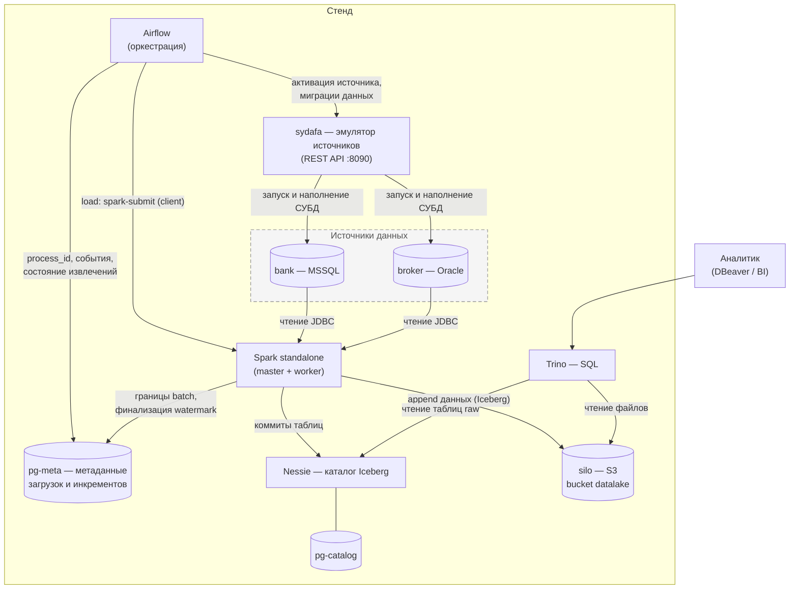

# datalake_stand — стенд КХД → DLH (raw-слой)

Локальный docker-compose стенд корпоративного хранилища данных: Airflow
оркестрирует загрузку таблиц из реляционных источников (MSSQL, Oracle) в
**raw-слой** озера на Iceberg. Raw-слой — точное зеркало таблиц источника «AS IS»
плюс технические колонки загрузки: без бизнес-логики, без преобразований, без
отбора колонок. Добавление новой таблицы в озеро — одна строка в манифесте
пайплайна и регенерация DAG-ов. Обработка данных (слои ods/dds/dma) строится
поверх raw в будущих этапах и raw при этом не меняется. Работа с данными —
SQL через Trino (DBeaver, BI) и Spark.

**Карта документации.** За каждым документом закреплена одна зона
ответственности; правила ведения документов — в [`AGENTS.md`](AGENTS.md),
раздел «Документация и процессы».

| Документ | О чём | Когда читать |
|---|---|---|
| `README.md` (этот файл) | Эксплуатация: архитектура и состав стенда, запуск и проверки, источники sydafa, обзор логики загрузки, тестирование; статус и планы проекта | поднять стенд, подключиться, проверить работу |
| [`docs/architecture.md`](docs/architecture.md) | Устройство: слои данных (raw/ods/dds), механика загрузки (манифесты, DAG-и, партии, инкремент), типы и гарантии, известные ограничения | понять, как устроена загрузка и где её границы |
| [`docs/demo.md`](docs/demo.md) | Пошаговый сценарий демонстрации с готовыми SQL- и JSON-запросами; документ самодостаточен и читается без остальной документации | показать стенд или познакомиться с ним быстро |
| [`docs/backlog.md`](docs/backlog.md) | Проработанные отложенные задачи | узнать открытые проблемы и согласованные решения |
| [`docs/graphify.md`](docs/graphify.md), [`docs/speckit.md`](docs/speckit.md) | Тулинг ИИ-агентов: граф кодовой базы; спек-цикл Spec Kit | настроить graphify / спек-цикл изменений |
| [`AGENTS.md`](AGENTS.md) | Правила для ИИ-агентов: маршруты по скиллам, зоны документов, git-процесс, стандарты кода | понять, по каким правилам агент работает с репозиторием |

**Содержание** README (эксплуатация стенда) — пять разделов: архитектура
стенда, работа со стендом, эмуляция источников, логика работы datalake
(обзор; подробно — `docs/architecture.md`), тестирование.

**Содержание**

1. [Архитектура стенда](#1-архитектура-стенда)
2. [Работа со стендом](#2-работа-со-стендом)
3. [Эмуляция источников (sydafa)](#3-эмуляция-источников-sydafa)
4. [Логика работы datalake](#4-логика-работы-datalake)
5. [Тестирование стенда](#5-тестирование-стенда)

---

## 1. Архитектура стенда

### 1.1. Назначение и ключевые решения

Стенд демонстрирует контур загрузки данных production-архитектуры DLH:

- **Слой = каталог.** Каждый слой озера — отдельный warehouse в Nessie и
  отдельный каталог в движках (`raw` сейчас; `ods`, `dds`, `dma` — будущие).
  Движки адресуют таблицы как `каталог.схема.таблица`, поэтому слой занимает
  слот каталога: `raw.bank.retail_bank__clients`.
- **Append-only.** Каждая загрузка дописывает новую порцию строк; строки в raw
  никогда не обновляются и не удаляются на месте. Полная история всех загрузок
  сохраняется как данные. Семантика — at-least-once: сбой после фиксации данных,
  но до фиксации watermark может привести к повторной записи порции при
  повторе (`docs/architecture.md`, разделы 4 и 7).
- **Устойчивость к эволюции схемы источника.** Новые колонки источника
  добавляются в таблицу озера автоматически, исчезнувшие заполняются NULL,
  изменение типа не проходит молча (`docs/architecture.md`, раздел 5).
- **Два контура.** Контур A — сам датахаб (Airflow, Spark, Nessie, Trino, silo,
  pg-catalog, pg-meta). Контур B — подключаемый эмулятор источников sydafa,
  который поднимает и наполняет СУБД-источники; в production вместо него были бы
  реальные базы.

### 1.2. Состав инстансов

| Инстанс | Образ/версия | Назначение |
|---|---|---|
| `sydafa` | `ghcr.io/georgekochergin/sydafa:latest` | Эмулятор источников: REST API для активации СУБД, транзакционных миграций схемы/данных и генерации синтетических данных (раздел 3) |
| `sydafa-src-mssql-bank` | `mcr.microsoft.com/mssql/server:2022-CU27` | Источник **bank** (MSSQL 2022, база `sydafa`, схема `retail_bank`); запускается sydafa лениво, по требованию |
| `sydafa-src-oracle-broker` | `gvenzl/oracle-free:23-slim-faststart` | Источник **broker** (Oracle Free 23, PDB `sydafa`, схема `trading_core`); запускается sydafa лениво |
| `spark-master` / `spark-worker` | `tabulario/spark-iceberg:3.5.5_1.8.1` + JDBC-драйверы MSSQL/Oracle | Spark 3.5.5 standalone-кластер; загрузка источников в Iceberg по JDBC, каталог `raw` через нативный NessieCatalog |
| `airflow-webserver` / `airflow-scheduler` / `airflow-dag-processor` | `apache/airflow:3.3.2-python3.11` (+ Spark, JDK 17, JDBC-jars) | Оркестрация: DAG-и обновления источников и DAG-и загрузки raw-слоя, LocalExecutor |
| `airflow-postgres` | `postgres:16.15` | Собственная база Airflow (метаданные DAG-ов, XCom) |
| `nessie` | `ghcr.io/projectnessie/nessie:0.99.0` | Каталог метаданных Iceberg (REST API), warehouse `raw` → `s3://datalake/raw/` |
| `pg-catalog` | `postgres:16.15` | Хранилище самого Nessie (JDBC version store) |
| `silo` + `silo-init` | `pgsty/silo` (MinIO-совместимый S3) | Объектное хранилище: bucket `datalake` (данные Iceberg); `silo-init` — одноразовое создание bucket |
| `trino` | `trinodb/trino:479` | SQL-движок над Iceberg: аналитика, проверка результатов загрузок; каталог `raw` |
| `pg-meta` | `postgres:16.15` | Операционная база фреймворка загрузки: идентификаторы процессов, события DAG-ов и тасков, состояние инкрементальных извлечений (`docs/architecture.md`, разделы 7–8) |
| `test-runner` (профиль `test`) | `python:3.12-slim` | Одноразовый контейнер e2e-тестов; на живом стенде не запускается (раздел 5) |

Spark подключается к Nessie через `NessieCatalog` (`/api/v2`, ветка `main`),
Trino — через Iceberg REST (`/iceberg`). Оба видят одни и те же таблицы.
Загрузчик RAW явно задаёт `LOCATION`: таблица
`raw.bank.retail_bank__accounts` хранится под
`s3://datalake/raw/bank/retail_bank__accounts/`, без UUID в имени директории.
Одного переключения каталога недостаточно: без явного `LOCATION` Nessie
по-прежнему добавляет UUID. Прямое создание таблиц через REST также не гарантирует
этот путь в используемой версии Nessie.

Существующие таблицы автоматически не переносятся. На тестовом стенде для перехода
можно выполнить полный сброс `docker compose down --remove-orphans --volumes`,
затем пересобрать образы через `docker compose up -d --build` и повторить загрузку.
Нельзя независимо создавать одноимённые таблицы в разных ветках Nessie с одним
`LOCATION`; нельзя вручную удалять или переименовывать их файлы в бакете.
Повторное создание удалённой таблицы по прежнему пути требует учитывать данные
и ссылки, оставшиеся в истории каталога; штатные загрузки таблицу не пересоздают.

### 1.3. Общая схема



Поток данных одной загрузки: Airflow выделяет `process_id` в pg-meta → будит
источник через sydafa → таск `load` отправляет spark-job в Spark → job читает
таблицу источника по JDBC, фиксирует границы извлечения в pg-meta **до**
чтения, дописывает порцию строк в Iceberg (физически — новые Parquet-файлы в
silo, метаданные таблицы — коммит в Nessie) и атомарно финализирует водяной
знак в pg-meta. Аналитик видит результат через Trino.

### 1.4. Требования к среде

Стенду нужен Docker-хост (для Docker Desktop — его виртуальная машина) с
**минимум 16 ГБ RAM**. Одновременно работают до двух СУБД-источников (MSSQL +
Oracle), кластер Spark, Airflow, Trino, Nessie, silo и три инстанса
PostgreSQL, а при параллельных загрузках — несколько Spark-приложений разом.
Дефолтных для Docker Desktop 8 ГБ не хватает: OOM-killer останавливает
контейнеры СУБД-источников и Trino прямо посреди загрузки (симптом — падение
load-тасков по JDBC-коннекту).

Проверка выделенной памяти:

```bash
docker info | grep "Total Memory"   # должно быть ≥ 16 GiB
```

В Docker Desktop память меняется в Settings → Resources → Memory (изменение
требует рестарта Docker).

**Python и библиотеки** по компонентам (фактические версии — в Dockerfile и
requirements соответствующих образов):

| Компонент | Python | Ключевые библиотеки |
|---|---|---|
| Контейнер Airflow (он же Spark-драйвер, client-mode) | 3.11 | Airflow 3.3.2; провайдеры apache-spark 6.3.2 и trino 6.7.0; pyspark 3.5.5; пакет `sydafa-airflow`; JDK 17; JDBC-драйверы mssql-jdbc 12.10 и ojdbc11 23.8 |
| Кластер Spark (executors) | 3.10 | Spark 3.5.5 + Iceberg 1.8.1 |
| test-runner | 3.12 | PyYAML 6.0.3 (остальное — stdlib) |
| Генератор DAG-ов (хост/CI) | 3.11+ | PyYAML ≥ 6 |
| Юнит-тесты на хосте | 3.11+ | PyYAML ≥ 6 (unittest) |

Рассинхрон Python 3.11 (Airflow) и 3.10 (Spark) не мешает JDBC/DataFrame-
загрузкам: Python-worker'ы на executors не запускаются; Python UDF/RDD
потребуют выравнивания minor-версий.

### 1.5. Структура репозитория

| Путь | Назначение |
|---|---|
| `airflow/` | Пользовательский код оркестрации: DAG-и обновления источников (`dags/update_source_*.py`), сгенерированные DAG-и загрузки (`dags/generated/`, артефакт, в git не попадают), плагины `plugins/ingestion` (операторы и реестр pg-meta) и `plugins/migrations` (батчи операций обновления источников) |
| `ingestion/spark/` | Spark-приложения загрузки по слоям и типам источников: `ingestion/spark/raw/rdbms/load_entity.py` — append-загрузчик одной сущности RDBMS (JDBC → Iceberg); compose монтирует каталог как `/opt/spark-jobs` |
| `ingestion/sources/` | Диалекты СУБД и общий JDBC-слой: `sources/rdbms/positions.py` — типизированные позиции инкремента, `sources/rdbms/dialects/` — адаптеры MSSQL/Oracle (URL, quoting, литералы, temporal-выражения), `sources/rdbms/registry.py` — реестр диалектов по conn_type/JDBC URL, `sources/rdbms/jdbc.py` — соединения и метаданные |
| `trino/` | Пользовательский SQL (каркас) |
| `ingestion/` | Единый дом процесса загрузки: `conf/` — манифесты источников (`sources.yaml`), пайплайнов (`pipelines/**/*.yaml`) и технические настройки (`settings.yaml`); `generator/` — генератор DAG-ов и валидация манифестов (`generate_dags.py`, `manifest.py`, `naming.py`, запуск `python3 -m ingestion.generator.generate_dags`); `operators.py` — операторы Airflow; `meta.py` — клиент pg-meta (партии и watermark); `iceberg.py` — DDL целевых raw-таблиц. Пакет целиком доставляется в контейнеры Airflow и Spark-драйвер (том + `PYTHONPATH=/opt/python`) |
| `conf/airflow` | Dockerfile и requirements образа Airflow (+ Spark, JDK, JDBC-драйверы), генератор паролей |
| `conf/spark` | Dockerfile и `spark-defaults.conf` (каталог `raw`: нативный NessieCatalog + S3FileIO в silo) |
| `conf/trino` | Конфигурация Trino: HTTPS + password-authenticator, каталог `raw` |
| `conf/silo` | `init-bucket.sh` — создание bucket `datalake` |
| `conf/pg-meta` | `init/01_ingestion.sql` — DDL операционной схемы загрузки (применяется контейнером при первом старте на пустом томе) |
| `conf/sydafa` | `sources.json` — декларативный манифест источников: схема таблиц, правила генерации, внешние порты |
| `docs/` | Документация: `architecture.md` (устройство загрузки и хранения), `demo.md` (сценарий демонстрации, самодостаточен), `backlog.md` (отложенные задачи), `graphify.md` и `speckit.md` (тулинг ИИ-агентов) |
| `test/` | e2e-тесты (`test.sh`, `run_flow.py`, `check_extraction.py`, `schema_evolution.py`, `temporal_extraction.py`) и юнит-тесты (`unit/`) |
| `.agents/skills/` | Рукописные скиллы команды (`e2e-testing`, `pull-request`, `backlog`); стандартный каталог Agent Skills — его нативно читают оба агента |
| `.specify/` | Общая инфраструктура Spec Kit: шаблоны, bash-скрипты, конституция (`memory/constitution.md`), состояние интеграций |
| `.opencode/commands/` | Команды для opencode (speckit-цикл); ставит и обновляет `specify` |
| `docker-compose.yaml` | Каркас стенда (проект `dlh-poc`) |
| `.env` | `STAND_USER` / `STAND_PASSWORD` (по умолчанию `admin123` / `admin123`) |

Каталоги `airflow/`, `trino/` — пользовательский код: compose монтирует их в
контейнеры (`plugins` — только чтение), в git через `.gitignore` попадают лишь
явно разрешённые поддеревья. Пакет `ingestion/` отслеживается в git целиком и
доставляется в контейнеры Airflow томом `./ingestion:/opt/python/ingestion:ro`
(импорт через `PYTHONPATH=/opt/python`), а его подкаталог `spark/` — ещё и в
кластер Spark как `/opt/spark-jobs`.

Каталоги ИИ-агентов разделены по владельцу и формату, а не дублируют друг
друга. `.agents/skills/` — общий каталог стандарта Agent Skills: его читают
все агенты, поддерживающие стандарт, поэтому в нём живут рукописные скиллы
команды. `.opencode/commands/` — команды Spec Kit, их ставит и обновляет
`specify` по манифестам, вручную файлы не переносятся; общая инфраструктура
цикла — в `.specify/`. Состав артефактов — `docs/speckit.md`, раздел 5.

### 1.6. Статус и планы

**Что работает** (подтверждается изолированным e2e-прогоном, раздел 5.2):

- загрузка из MSSQL 2022 и Oracle Free 23 (состав и версии всех инстансов —
  раздел 1.2);
- полные снапшоты и инкрементальные загрузки с окном и lookback, включая
  temporal-позиции с наносекундной точностью;
- append-only raw-слой на Iceberg с полной историей загрузок;
- устойчивость к эволюции схемы источника (добавление/удаление/переименование
  колонок);
- эмуляция источников sydafa и изолированный тестовый контур.

**Что планируется:**

- ODS поверх raw: дедупликация по ключам и актуальное состояние (SCD2);
- DDS на Data Vault;
- Kafka как тип источника;
- новые СУБД-источники: Greenplum, ClickHouse;
- dbt для трансформаций;
- security: авторизация и изоляция доступа к слоям озера.

Пункт планов, у которого появилось проработанное решение, переезжает задачей
в [`docs/backlog.md`](docs/backlog.md) со ссылкой на этот список. Туда же
попадают проблемы существующего кода, найденные в ходе разработки: решение —
рефакторинг в том же PR либо запись в бэклог, проигнорировать находку нельзя.

---

## 2. Работа со стендом

### 2.1. Запуск и остановка

Предусловия: Docker + Docker Compose, ≥16 ГБ RAM для Docker (раздел 1.4),
склонированный репозиторий с `.env`. Образ эмулятора
`ghcr.io/georgekochergin/sydafa:latest` загружается из GHCR автоматически,
если его нет локально. Для обновления уже скачанного образа выполните
`docker compose pull sydafa` перед запуском.

Образ sydafa опубликован для `linux/amd64`; Compose явно задаёт эту платформу,
поэтому на Apple Silicon он запускается через эмуляцию Docker Desktop.
При первом старте sydafa инициализирует СУБД и схемы до готовности HTTP API;
healthcheck допускает стартовый период 15 минут (включая загрузку образов СУБД).
Сервисы Airflow и test-runner с локальными Dockerfile используют
`pull_policy: build`: Compose собирает их, а не ищет локальные имена образов
в Docker Hub. Повторный `up` запускает сборку с использованием кеша.

Другой образ можно указать через `SYDAFA_IMAGE` в `.env` или окружении.
Для локальной разработки из соседнего клона
[sydafa](https://github.com/georgekochergin/sydafa):

```bash
docker build -t sydafa:latest ../sydafa
SYDAFA_IMAGE=sydafa:latest docker compose up -d
```

Интернет нужен только для первой загрузки/сборки образов — повторные запуски
работают офлайн.

```bash
docker compose up -d                # запуск стенда (используются собранные образы)
docker compose ps                   # статус сервисов
docker compose logs -f <сервис>     # логи конкретного сервиса
docker compose stop                 # остановка без удаления контейнеров
docker compose start                # повторный запуск остановленного стенда
docker compose down                 # остановка и удаление контейнеров и сетей (тома остаются)
```

> **Не используйте `docker compose up --build`.** В этой форме Docker Compose
> пытается скачать образы сервисов без секции `build` (например, `sydafa`) из
> внешнего репозитория и завершается ошибкой `pull access denied`, даже когда
> образ уже есть локально. Пересборка выполняется отдельной командой:

```bash
docker compose build && docker compose up -d   # пересборка образов и запуск
```

Полный сброс с потерей всех данных (`down -v` удаляет тома: данные озера,
источников, метаданные Airflow и pg-meta):

```bash
docker compose down -v --remove-orphans
```

Контейнеры источников создаёт sydafa через Docker API; Compose удаляет их как
orphan-контейнеры по меткам родительского проекта. Тома источников явно объявлены
в `docker-compose.yaml`, поэтому `--volumes` удаляет и их. Без `--volumes` данные
сохраняются. Требуется образ sydafa с поддержкой Compose cleanup; после обновления
кода sydafa пересоберите его образ. Старые контейнеры без этих меток необходимо
однократно удалить вручную.

Не используйте `docker compose up --remove-orphans`: динамические источники не
описаны как сервисы YAML и также будут удалены этой командой. Для обычного запуска
используйте `docker compose up -d`. Префикс `SYDAFA_CONTAINER_PREFIX` должен быть
одинаковым при запуске и очистке; для параллельных проектов задавайте разные префиксы.

После `down -v` стенд поднимается с нуля: источники пересоздаются по
`conf/sydafa/sources.json`, pg-meta инициализируется DDL из `conf/pg-meta/init/`.

Изменения кода в `airflow/`, `ingestion/`, `trino/`, `conf/` подхватываются
пересозданием контейнеров; изменение Dockerfile/requirements требует пересборки
(`docker compose build`, затем `docker compose up -d`).

### 2.2. Порты

| Сервис | Порт на хосте | Примечание |
|---|---|---|
| sydafa (REST, Swagger UI) | 8090 | без авторизации |
| nessie (Iceberg REST) | 19120 | движки используют внутреннее имя; наружу опубликован для отладки |
| silo: S3 API / веб-консоль | 9000 / 9001 | |
| spark-master UI | 8080 | порт 7077 (master RPC) тоже опубликован |
| spark-worker UI | 8081 | |
| trino (HTTPS) | 8443 | внутренний HTTP 8080 не опубликован — им пользуется только Airflow внутри сети |
| airflow webserver | 8089 | |
| pg-meta (PostgreSQL) | 55432 | операционная БД загрузок; подключение из DBeaver — раздел 2.5 |
| bank, MSSQL (при активации) | 14330 | внешний порт источника из `sources.json` |
| broker, Oracle (при активации) | 15211 | внешний порт источника из `sources.json` |

Не опубликованы наружу (доступны только внутри сети стенда): `pg-catalog`,
`airflow-postgres`.

### 2.3. Веб-интерфейсы

| Сервис | URL | Логин/пароль |
|---|---|---|
| Airflow | http://localhost:8089 | `admin123` / `admin123` |
| Spark Master UI | http://localhost:8080 | без авторизации |
| Spark Worker UI | http://localhost:8081 | без авторизации |
| silo, веб-консоль | http://localhost:9001 | `admin123` / `admin123` |
| sydafa, Swagger UI | http://localhost:8090/docs | без авторизации |

В Airflow UI видны шесть DAG-ов: два обновления источников
(`update_source_bank`, `update_source_broker`) и четыре загрузки raw-слоя
(`ingest__rdbms__bank__main`, `ingest__rdbms__bank__refs`,
`ingest__rdbms__broker__main`, `ingest__rdbms__broker__refs`). Запуск — кнопка
треугольника справа (DAG-и не на паузе, расписания нет — только ручной запуск).

В Health-странице триггерер (Triggerer) горит красным — это ожидаемо: сервис
не развёрнут, потому что на стенде нет отложенных (deferrable) операторов, для
которых он нужен. Обнаружение новых и исчезнувших файлов DAG-ов настроено
быстрым (`AIRFLOW__DAG_PROCESSOR__REFRESH_INTERVAL=10`): сгенерированные DAG-и
появляются в UI через секунды, а после удаления каталога `generated/`
деактивируются примерно в течение минуты.

### 2.4. Подключение к Trino из DBeaver

Драйвер «Trino» встроен в DBeaver:

- Host: `localhost`, Port: `8443`;
- Use SSL: да (Trino работает по HTTPS с самоподписанным сертификатом);
- Catalog/Database: `raw`;
- Username/Password: `admin123` / `admin123` (password-authenticator, конфиг в
  `conf/trino/`);
- Driver properties: `SSL=true;SSLVerification=NONE`;
- JDBC URL: `jdbc:trino://localhost:8443/raw?SSL=true&SSLVerification=NONE`.

Обзор озера и типовые запросы к raw-таблицам — `docs/architecture.md`,
разделы 4–5.

### 2.5. Подключение к pg-meta (DBeaver)

Операционная база фреймворка загрузки опубликована на хост портом 55432.
В DBeaver — драйвер PostgreSQL:

- Host: `localhost`, Port: `55432`, Database: `meta`;
- Username/Password: `admin123` / `admin123`;
- JDBC URL: `jdbc:postgresql://localhost:55432/meta`.

Схема таблиц — `ingestion`. Быстрый просмотр без DBeaver — psql в контейнере:

```bash
docker compose exec pg-meta psql -U admin123 -d meta -c '\dt ingestion.*'
```

Состав таблиц и смысл каждой колонки — `docs/architecture.md`, разделы 7–8.

### 2.6. Учётные данные

В `.env` заданы только `STAND_USER` и `STAND_PASSWORD` (по умолчанию оба
`admin123`); из них выводятся пароли Airflow, Trino, silo и трёх PostgreSQL.
Пароль silo должен быть не короче 8 символов. Технические ключи (TLS, JWT) не
заменяются этим паролем. Изменение env не меняет роли в уже инициализированных
томах Postgres — для тестового стенда допустима переинициализация `down -v`.

- **Источники СУБД (MSSQL, Oracle)**: `sydafa` / `sydafa` — читатель с правами
  только `SELECT`; используется Spark-загрузчиком и подключениями из DBeaver
  (раздел 3.3). Административный доступ извне закрыт.
- **Trino**: `admin123` / `admin123` — SQL-запросы (CLI, DBeaver, BI).
- **Airflow UI**: `admin123` / `admin123`.
- **silo (консоль и S3 API)**: `admin123` / `admin123`.
- **PostgreSQL стенда (pg-catalog, pg-meta, airflow-postgres)**: `admin123` /
  `admin123`; наружу опубликован только pg-meta (порт 55432, раздел 2.5).
- Без авторизации: Spark Master/Worker UI, sydafa Swagger UI.

### 2.7. Проверка после старта

Чек-лист «стенд поднялся корректно» — проходится по порядку:

1. **Сервисы.** `docker compose ps` — все долгоживущие сервисы в состоянии
   `Up`: airflow-webserver, airflow-scheduler, airflow-dag-processor,
   spark-master, spark-worker, trino, nessie, silo, pg-catalog, pg-meta,
   airflow-postgres, sydafa. One-shot сервис `airflow-init` завершается
   (exit 0) — это норма.
2. **Память.** `docker info | grep "Total Memory"` — не меньше 16 GiB
   (раздел 1.4); при нехватке OOM-killer роняет СУБД-источники и Trino
   посреди загрузок.
3. **Логи Airflow.** `docker compose logs airflow-dag-processor 2>&1 | tail -50`
   — парсинг каталога `dags/` без ошибок (в Airflow 3 парсингом занимается
   отдельный сервис dag-processor, а не scheduler);
   `docker compose logs airflow-scheduler 2>&1 | tail -50` — без traceback.
4. **DAG-и в UI.** В Airflow (раздел 2.3) шесть DAG-ов: два `update_source_*`
   и четыре `ingest__rdbms__*`; красный Triggerer на Health-странице —
   ожидаемо. Сгенерированные DAG-и не появились — выполните генерацию
   (раздел 4) и подождите до минуты.
5. **Источники.** `curl -s localhost:8090/health` — sydafa отвечает (Swagger
   UI — раздел 2.3). СУБД-источники поднимаются при первом обращении:
   активация — раздел 3.2.
6. **Данные после загрузки.** После успешного запуска ingest-DAG-ов проверьте
   наполнение raw через Trino: `count(*)`, число порций по
   `__process_id`/`__batch_id` (готовые запросы — `docs/architecture.md`,
   раздел 4).
7. **Контур целиком.** Полный изолированный e2e-прогон — `./test/test.sh`
   (поднимает отдельный тестовый контур `dlh-test` и гасит его, раздел 5.2).
   Живой стенд (`dlh-poc`) этим скриптом не проверяется: шаги 1–6 выше —
   его ручная проверка.

---

## 3. Эмуляция источников (sydafa)

### 3.1. Что такое sydafa

**sydafa** (Synthetic Data Factory & DB Orchestrator) — автономный сервис из
отдельного репозитория [georgekochergin/sydafa](https://github.com/georgekochergin/sydafa).
Полная документация, спецификация REST API и семантика генераторов — там; здесь
только то, что нужно для работы со стендом.

На стенде sydafa играет роль «настоящих» источников данных:

- лениво оркеструет контейнеры СУБД `sydafa-src-mssql-bank` /
  `sydafa-src-oracle-broker` через Docker API (данные — в named volume; пока
  источник не нужен, контейнер СУБД остановлен и не потребляет память);
- создаёт рабочую базу/PDB `sydafa` и читателя `sydafa` / `sydafa` (только
  чтение);
- генерирует синтетические данные по декларативным правилам (генераторы
  `sequence`, `faker`, `choice`, `random_decimal`, `random_date`, `date_offset`,
  инвариант `cumulative_balance`);
- выполняет транзакционные батчи DDL+DML «всё или ничего» — это механизм
  «жизни» источников: вставки, обновления, удаления, эволюция схемы.

Конфигурация источников стенда: `conf/sydafa/sources.json` — декларативный
источник правды по топологии (схемы таблиц, первичные и внешние ключи, правила
генерации, внешний порт `external_port` для подключения с хоста).

### 3.2. Активация источника и подключение из DBeaver

СУБД-источник по умолчанию остановлен. Перед подключением из DBeaver его нужно
поднять по TTL (после истечения TTL sydafa сам аккуратно остановит контейнер):

1. Откройте Swagger UI: http://localhost:8090/docs.
2. Выполните `POST /sources/{bank|broker}/activate?ttl_minutes=20` («Try it
   out» → «Execute»). Максимум TTL — 30 минут.
3. Из ответа возьмите объект `connection` — готовые параметры подключения:

```json
{
  "type": "mssql",
  "host": "localhost",
  "port": 14330,
  "database": "sydafa",
  "user": "sydafa",
  "password": "sydafa",
  "jdbc_url": "jdbc:sqlserver://localhost:14330;databaseName=sydafa;..."
}
```

4. Подключитесь в DBeaver (реквизиты везде `sydafa` / `sydafa`):
   - **bank, MSSQL**: драйвер SQL Server, host `localhost`, port `14330`,
     database `sydafa` (схема `retail_bank`);
   - **broker, Oracle**: драйвер Oracle, host `localhost`, port `15211`,
     service name `sydafa` (схема `trading_core`), SID оставьте пустым.
     Все объекты broker созданы в нижнем регистре (квотированные идентификаторы
     Oracle): в SQL-запросах обращайтесь к ним в кавычках —
     `SELECT * FROM "trading_core"."transactions"`; дерево каталога DBeaver
     показывает их в нижнем регистре без дополнительных настроек.
5. Ранний доступ к СУБД изнутри сети стенда (для сервисов): внутренние имена
   `sydafa-src-mssql-bank:1433`, `sydafa-src-oracle-broker:1521` — именно их
   использует Spark.

В каждой таблице источника sydafa ведёт служебную колонку `_batch_id bigint` —
номер партии наполнения; она растёт при вставках и служит колонкой инкремента
для таблицы `transactions` (`docs/architecture.md`, раздел 7).

Освободить память принудительно: `POST /sources/{source}/deactivate`.

### 3.3. Основные эндпоинты

| Метод | Путь | Назначение |
|---|---|---|
| GET | `/health` | Готовность API sydafa (не означает, что СУБД запущена) |
| GET | `/sources` | Список сконфигурированных источников |
| GET | `/sources/{source}` | Метаданные источника: таблицы, статус, `connection` (СУБД не будит) |
| GET | `/sources/{source}/schema` | Живая схема: таблицы, колонки, типы, генераторы, PK/FK |
| GET | `/sources/{source}/status` | Состояние контейнера (idle/running), остаток TTL |
| POST | `/sources/{source}/activate` | Запуск СУБД + TTL (`?ttl_minutes=20`; сам будит базу) |
| POST | `/sources/{source}/deactivate` | Принудительная остановка СУБД |
| POST | `/sources/{source}/migrate` | Транзакционный батч DDL+DML «всё или ничего» (будит базу) |
| GET/PUT/DELETE | `/sources/{source}/rules/{entity_fqn}` | Профиль генераторов таблицы: `columns` (колонка → генератор) и `invariants`; PUT перезаписывает профиль целиком |

Операции `migrate` (дискриминатор `op`): схема — `create_schema`,
`rename_schema`, `drop_schema`; таблицы — `create_table`, `rename_table`,
`transfer_table`, `drop_table`; колонки — `add_column`, `rename_column`,
`drop_column`; данные — `append` (строк `rows`), `update` (`predicate` + `set`
+ `limit`), `delete` (`predicate`/`limit`/`cascade`), `truncate`. Готовые
примеры батчей — в `docs/demo.md`.

### 3.4. DAG-и обновления источников

`update_source_bank` и `update_source_broker` (ручной запуск) — «оживление»
данных между раундами загрузки. Один таск `migrate` (`SydafaMigrateOperator`
пакета `sydafa-airflow`) применяет транзакционный батч операций из
`airflow/plugins/migrations/{bank,broker}.json`:

- вставки: +20 clients, +20 accounts, +200 deals, +5000 transactions;
- каскадное удаление 10 случайных сделок (`cascade: true` — вместе со
  ссылающимися транзакциями);
- точечные обновления справочников (2 clients, 2 accounts, 10 deals — статус
  или категория).

Именно после запуска этих DAG-ов инкрементальные загрузки видят новую дельту, а
снапшотные — выросшие таблицы.

### 3.5. Добавление источника и сброс к манифесту

Для нового источника необходимо синхронно обновить манифест и Compose:

1. Добавить описание в `conf/sydafa/sources.json` (тип `mssql` / `oracle`,
   свободный `external_port`, схема и правила генерации).
2. В `docker-compose.yaml` объявить именованный том с точным именем по шаблону
   `${SYDAFA_CONTAINER_PREFIX:-sydafa}-data-<тип>-<имя источника>` и подключить его
   к сервису `sydafa` под `/source-volumes/<имя источника>`. Например, для
   MSSQL-источника `crm`:

   ```yaml
   volumes:
     sydafa_crm_data:
       name: ${SYDAFA_CONTAINER_PREFIX:-sydafa}-data-mssql-crm

   services:
     sydafa:
       volumes:
         - sydafa_crm_data:/source-volumes/crm
   ```

   Это дополнения к существующим секциям, а не замена остальных томов.
   Директорию на хосте создавать не нужно: путь находится внутри контейнера.
3. Добавить то же подключение `sydafa_crm_data:/source-volumes/crm` в
   `services.sydafa.volumes` файла `test/docker-compose.override.yaml`: его
   `!override` заменяет весь список подключений. Имя тома берётся из базового
   Compose-файла и использует изолированный префикс тестового запуска.
4. Пересоздать сервис командой `docker compose up -d sydafa`: одного `restart`
   недостаточно для применения новых подключений. Ранее инициализированные базы
   не должны сбрасываться; наполнение нового источника выполняется через миграции.

**Ограничение:** sydafa не дополняет Compose-файлы автоматически. При добавлении
источника только в `sources.json` его динамический контейнер будет удаляться через
`--remove-orphans`, но удаление его тома через `--volumes` не гарантируется:
Compose должен знать том из своей конфигурации, причём неиспользуемые объявления
томов исключаются из модели. Даже будущая унификация очистки данных в `/reinit`
не отменяет требования поддерживать эти объявления и подключения.

Сброс источников строго по `sources.json` —
`docker compose down --remove-orphans --volumes` (полный сброс стенда, см. 2.1).

---

## 4. Логика работы datalake

Подробное устройство — [`docs/architecture.md`](docs/architecture.md); здесь —
краткая картина и указатели на его разделы.

**Конфигурация → DAG-и.** DAG-и загрузки не пишутся руками: генератор
`python3 -m ingestion.generator.generate_dags` статически превращает
YAML-манифесты (`ingestion/conf/`) в готовые файлы `airflow/dags/generated/`
(каталог — артефакт, в git не попадает). Один YAML-файл = один DAG; ошибки
конфигурации ловятся на генерации, до Airflow; добавление таблицы — одна
строка в манифесте. Разделы 2–3 architecture.md.

**Запуск DAG-а.** `generate_process_id` (идентификатор запуска) →
`activate_source` (разбудить СУБД через sydafa) → группы сущностей:
`log_start → load → log_end → publish_asset`. Load — отдельное Spark-приложение
(JDBC → Iceberg); параллельность загрузок сдерживает пул Airflow
`ingest_loads`. Раздел 3 architecture.md.

**Raw-таблицы.** Точное зеркало схемы источника плюс технические колонки
`__load_dttm` / `__process_id` / `__batch_id`; append-only, партиционирование
`days(__load_dttm)`; DDL создаётся автоматически по фактически прочитанной
схеме. Одна загрузка одной таблицы = одна партия с замороженными границами
окна. Раздел 4 architecture.md (там же — типовые SQL-запросы проверки данных
через Trino).

**Слои.** raw — первый слой; ODS (дедупликация по ключам, актуальное
состояние), DDS и витрины — будущие слои поверх raw, сам raw не меняется.
Раздел 1 architecture.md.

**Эволюция схемы.** Новые колонки источника добавляются в таблицу
автоматически (`mergeSchema`), исчезнувшие читаются NULL, смена типа — честный
отказ, порядок колонок не важен. Раздел 5 architecture.md.

**Параллелизм.** JDBC-партиции включаются только при MIN < MAX по выбираемой
автоматически колонке (колонка всегда одна); без PK/уникального индекса и
подходящего кандидата — один поток; temporal-инкремент всегда однопоточен.
Раздел 6 architecture.md.

**Инкремент.** Строго типизированные позиции (целые, `decimal(p,0)`, дата,
моменты с точностью 0–9), окно `lower < col <= upper`, lookback; watermark
и партии — в pg-meta с CAS-защитой от повторов и конкуренции; ручной полный
снимок — через Configuration JSON в диалоге запуска DAG-а. Раздел 7
architecture.md.

**Метаданные.** pg-meta — операционная база фреймворка: идентификаторы
процессов, журналы DAG-ов и тасков, состояние сущностей, партии извлечений,
аудит миграций контракта. Раздел 8 architecture.md.

**Типы и гарантии, известные ограничения** (at-least-once, тихие пропуски
инкремента при поздних коммитах, поддерживаемые СУБД, границы партиций дня и
прочее) — разделы 9–10 architecture.md.
---

## 5. Тестирование стенда

За проведение тестирования агентом отвечает скилл **`e2e-testing`**
(`.agents/skills/e2e-testing/SKILL.md`): он описывает принципы, устройство
тестового контура и траблшутинг. Правило кодовой базы: любой новый или
изменённый функционал пайплайнов, операторов и интеграций обязан
сопровождаться проверками в сценарии e2e-тестирования; чистые функции
дополнительно покрываются юнит-тестами с проверкой краевых случаев.

### 5.1. Юнит-тесты

```bash
python3 -m unittest discover -s test/unit
```

Покрывают чистые функции без стенда: валидацию манифестов и именование,
детерминизм генератора DAG-ов, парсеры аргументов загрузчика, типизированные
позиции и диалектные SQL-кодеки инкремента, реестр партий (при заданной
переменной окружения `EXTRACTION_TEST_DSN` — также интеграционные тесты
против одноразового Postgres), guard-ы стиля кода (запрет комментариев `#` в
Python) и DDL pg-meta (запрет триггеров). На хосте нужны Python 3.11+ и
PyYAML, например в изолированном окружении:
`python3 -m venv .venv && .venv/bin/pip install 'PyYAML>=6'`.

### 5.2. Полный e2e-прогон

```bash
./test/test.sh
```

Полностью изолированный тестовый проект `dlh-test` — безопасен при
одновременно работающем живом стенде: собственное дерево файлов
(`test/.workspace/`, удаляется по завершении), собственные тома и контейнеры,
отключённая публикация портов, префикс `sydafa-test-` для СУБД-источников.
Прогон по шагам:

1. статическая валидация манифестов, миграций и DAG-ов (`run_flow.py
   --validate-manifests-only`) и юнит-тесты;
2. генерация DAG-ов генератором;
3. сборка и подъём изолированного стека;
4. в `test-runner` (`run_flow.py`): health-проверки sydafa/Trino/Airflow,
   защита от SQL-инъекций (HTTP 422), запуск DAG-ов обновления источников и
   **несколько раундов загрузки** с проверками в Trino: append-only-семантика,
   один `__process_id` на запуск, удвоение снапшотов при повторе,
   инкрементальный гейт (повторная загрузка без изменений источника не пишет
   ни одной строки), дельта после обновления источника;
5. в `airflow-scheduler` (`check_extraction.py`): инварианты реестра партий —
   заморозка границ, повторы, no-op без Spark, защита watermark от
   регрессии и конкурирующих исполнителей, аудит ручной миграции;
6. отдельные Spark-приложения: эволюция схемы Iceberg (add/drop/rename колонок,
   честный отказ при несовместимом типе) и контракты temporal-инкремента
   (точность до наносекунд, границы окна, lookback);
7. гашение стекa и очистка только принадлежащих тестовому контуру
   контейнеров/томов (в т.ч. при неудаче — с выгрузкой логов Airflow в
   `TEST_FAILURE_LOG_DIR`).

Критерий: `FAIL=0`, exit-code `0`. Не допускается сдача задач при непройденных
проверках.

Опции: `TEST_SKIP_BUILD=1 ./test/test.sh` — полный сценарий без повторной
сборки образов (использовать только после сборки текущих Dockerfile/конфигов);
`./test/test.sh --verify` — повторные runtime-проверки на уже поднятом
**тестовом** контуре `dlh-test` (например, при отладке после полного прогона:
скрипт требует существующий `test/.workspace` и работает только внутри
изолированного тестового проекта; живой стенд им не проверяется).

Версии Python по компонентам и их рассинхрон — раздел 1.4.
