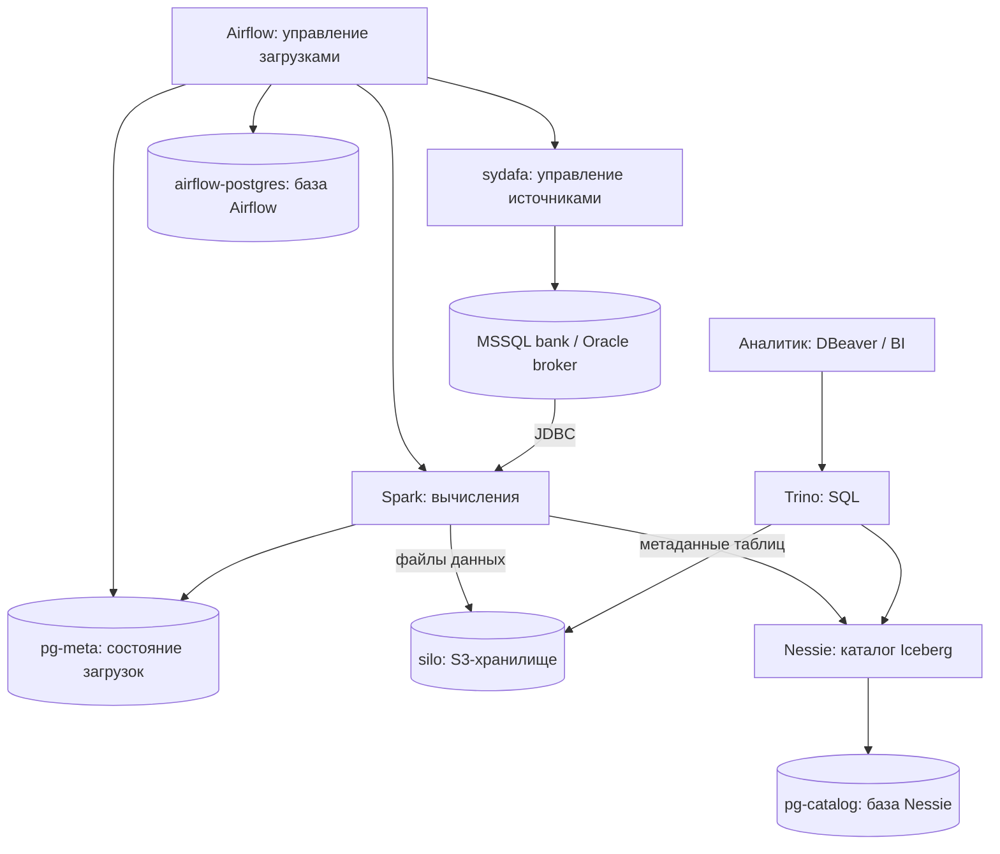

# datalake_stand — стенд хранилища и озера данных

Локальный стенд на Docker Compose: данные из MSSQL и Oracle загружаются
в озеро на Apache Iceberg. Загрузками управляет Airflow, вычисления выполняет
Spark, SQL-запросы — Trino. Источники с тестовыми данными создаёт сервис sydafa.

Сейчас реализован **[raw-слой](docs/glossary.md#term-raw)**: данные источников без бизнес-преобразований
с техническими отметками загрузки. Слои обработки и витрины пока планируются.
Стенд предназначен для разработки и демонстраций, а не для размещения
в открытой сети: часть интерфейсов не требует авторизации.

## Содержание

- [Документация](#документация)
- [Глоссарий](docs/glossary.md)
- [1. Устройство стенда](#1-устройство-стенда)
  - [Схема взаимодействия](#схема-взаимодействия)
  - [Docker-образы и приложения](#docker-образы-и-приложения)
  - [Языки и библиотеки](#языки-и-библиотеки)
    - [JDBC-драйверы в образах Airflow и Spark](#почему-jdbc-драйверы-установлены-в-обоих-образах)
- [2. Требования и запуск](#2-требования-и-запуск)
  - [Требования к среде](#требования-к-среде)
  - [Первый запуск](#первый-запуск)
  - [Остановка и обновление](#остановка-и-обновление)
  - [Полный сброс данных](#полный-сброс-данных)
- [3. Подключения](#3-подключения)
  - [Веб-интерфейсы и порты](#веб-интерфейсы-и-порты)
  - [Trino в DBeaver](#trino-в-dbeaver)
  - [PostgreSQL pg-meta в DBeaver](#postgresql-pg-meta-в-dbeaver)
  - [Учётные данные](#учётные-данные)
- [4. Источники sydafa](#4-источники-sydafa)
  - [Активация и подключение](#активация-и-подключение)
  - [API и обновление данных](#api-и-обновление-данных)
  - [Добавление источника](#добавление-источника)
- [5. Проверка стенда](#5-проверка-стенда)
- [6. Структура репозитория](#6-структура-репозитория)
- [7. Статус и планы](#7-статус-и-планы)

## Документация

| Документ | Когда читать |
|---|---|
| README (этот файл) | Запустить стенд, узнать состав и подключиться к сервисам |
| [Архитектура загрузчика](docs/architecture.md) | Настроить загрузку, разобраться в DAG-ах, таблицах и гарантиях |
| [Расширение стенда](docs/extending.md) | Подключить новую JDBC-СУБД, спроектировать другой тип источника или слой данных |
| [Демонстрация](docs/demo.md) | Пройти готовый сценарий с SQL и API-запросами |
| [Бэклог](docs/backlog.md) | Посмотреть согласованные отложенные задачи |
| [Глоссарий](docs/glossary.md) | Найти определения терминов проекта |
| [graphify](docs/agents/graphify.md) | Настроить граф кодовой базы для ИИ-агентов |
| [Spec Kit](docs/agents/speckit.md) | Работать над функциональными изменениями по спецификациям |
| [AGENTS.md](AGENTS.md) | Узнать правила работы агента с репозиторием |

## 1. Устройство стенда

### Схема взаимодействия



- **sydafa** запускает СУБД и наполняет их синтетическими данными.
- **Airflow** запускает загрузки в Spark.
- **Spark** читает источники по JDBC и записывает таблицы Iceberg в silo.
- **Nessie** хранит каталог таблиц. Собственные данные Nessie размещены в pg-catalog.
- **Trino** получает описание таблиц из Nessie, а файлы читает из silo.
- **pg-meta** хранит журналы и состояние загрузок. Это не база Airflow и не каталог Iceberg.

Spark и Trino видят один каталог `raw` и одни таблицы. Например:
`raw.bank.retail_bank__clients`. Данные находятся в [бакете](docs/glossary.md#term-bucket) `datalake`
S3-хранилища silo.

### Docker-образы и приложения

Версии ниже заданы конфигурацией репозитория. Это состав сборки, а не
проверенные минимальные версии. Основной файл — [docker-compose.yaml](docker-compose.yaml).

| Сервис | Образ или базовый образ | Назначение |
|---|---|---|
| `sydafa` | `ghcr.io/georgekochergin/sydafa:latest` | API эмулятора источников |
| `sydafa-src-mssql-bank` | `mcr.microsoft.com/mssql/server:2022-CU27` | Источник bank, MSSQL 2022 |
| `sydafa-src-oracle-broker` | `gvenzl/oracle-free:23-slim-faststart` | Источник broker, Oracle Free 23 |
| `spark-master`, `spark-worker` | `tabulario/spark-iceberg:3.5.5_1.8.1` | Spark 3.5.5 и Iceberg 1.8.1, локальная сборка с JDBC-драйверами |
| `airflow-webserver`, `airflow-scheduler`, `airflow-dag-processor`, `airflow-init` | `apache/airflow:3.3.2-python3.11` | Локальная сборка Airflow со Spark и JDK 17, LocalExecutor |
| `airflow-postgres`, `pg-catalog`, `pg-meta` | `postgres:16.15-bookworm` | Три отдельные базы метаданных |
| `nessie` | `ghcr.io/projectnessie/nessie:0.99.0` | Каталог Iceberg |
| `silo` | `pgsty/silo:RELEASE.2026-09-16T00-00-00Z` | MinIO-совместимое S3-хранилище |
| `silo-init` | `amazon/aws-cli:2.17.0` | Одноразовое создание [бакета](docs/glossary.md#term-bucket) |
| `trino` | `trinodb/trino:479` | SQL-доступ к озеру |
| `trino-init` | `httpd:2-alpine` | Одноразовая подготовка авторизации Trino |
| `test-runner` | `python:3.12-slim` | Локальная сборка тестового контейнера, профиль `test` |

Контейнеры СУБД создаёт sydafa по требованию. Остальные сервисы запускает Compose.
Теги `latest` и `2-alpine` не закрепляют точную сборку образа.

### Языки и библиотеки

Прикладной код написан на Python. SQL используется для запросов и описания
таблиц, Bash — для служебных сценариев, YAML и JSON — для конфигурации.

| Окружение | Версии и зависимости |
|---|---|
| Airflow и Spark [driver](docs/glossary.md#term-driver) | Python 3.11, JDK 17, PySpark 3.5.5, Spark provider 6.3.2, Trino provider 6.7.0, `sydafa-airflow` |
| Spark [executors](docs/glossary.md#term-executor) | Python 3.10, Spark 3.5.5, Iceberg 1.8.1 |
| JDBC-драйверы | MSSQL `12.10.0.jre11`, Oracle `23.8.0.25.04` |
| Генератор и [unit-тесты](docs/glossary.md#term-unit) на хосте | Python 3.11+, зависимости из `ingestion/generator/requirements.txt` |
| Тестовый контейнер | Python 3.12, PyYAML 6.0.3 |

На стенде [driver](docs/glossary.md#term-driver) работает в `airflow-scheduler`, [executors](docs/glossary.md#term-executor) — в `spark-worker`.
Текущие JDBC/DataFrame-загрузки не запускают Python-процессы на [executors](docs/glossary.md#term-executor).
Для Python [UDF](docs/glossary.md#term-udf) и [RDD](docs/glossary.md#term-rdd) потребуется одинаковая minor-версия Python у [driver](docs/glossary.md#term-driver) и [executors](docs/glossary.md#term-executor).

Файлы сборки: [Airflow](conf/airflow/Dockerfile),
[его зависимости](conf/airflow/requirements.txt), [Spark](conf/spark/Dockerfile),
[test-runner](test/Dockerfile).

#### Почему JDBC-драйверы установлены в обоих образах

`mssql-jdbc-12.10.0.jre11.jar` и `ojdbc11-23.8.0.25.04.jar` нужны
в двух окружениях Spark-приложения:

| Образ | Кто использует JDBC-драйверы | Для чего |
|---|---|---|
| Airflow (`conf/airflow/Dockerfile`) | Spark [driver](docs/glossary.md#term-driver) в `airflow-scheduler` | Подготовительные запросы к источнику: схема, типы, метаданные и границы чтения |
| Spark (`conf/spark/Dockerfile`) | [Executors](docs/glossary.md#term-executor) в `spark-worker` | Чтение строк источника задачами Spark |

Airflow запускает `spark-submit` в режиме `client`: [driver](docs/glossary.md#term-driver)
остаётся в контейнере, откуда отправлено приложение, а не переносится на `spark-worker`.
Поэтому JAR-файлы в образе Airflow — зависимости выполняемого там Spark-кода,
а не JDBC-подключение самого оркестратора.

Образы общие для нескольких сервисов. Поэтому эти JAR-файлы также присутствуют
в остальных контейнерах Airflow и в `spark-master`, хотя нужны прежде всего
[driver](docs/glossary.md#term-driver) и [executors](docs/glossary.md#term-executor).
Планируемый перенос зависимостей в отдельный контейнер загрузки описан в
[задаче перехода на DockerOperator](docs/backlog.md#изолировать-spark-drivers-через-dockeroperator).

## 2. Требования и запуск

### Требования к среде

- Docker и Docker Compose.
- Не менее **16 ГБ RAM**, выделенных Docker-хосту или виртуальной машине Docker Desktop.
- Клон репозитория и `.env` с `STAND_USER` и `STAND_PASSWORD`.
- Интернет для загрузки образов и зависимостей при первой сборке.

Проверка памяти:

```bash
docker info | grep "Total Memory"
```

В Docker Desktop лимит меняется в Settings → Resources → Memory.
При нехватке памяти Docker может остановить Trino или СУБД прямо во время загрузки.

sydafa использует платформу `linux/amd64`. На Apple Silicon Compose запускает
его через эмуляцию Docker Desktop.

### Первый запуск

Из корня репозитория:

```bash
docker compose up -d
docker compose ps
```

- Airflow и test-runner используют `pull_policy: build`: Compose собирает локальные образы.
- При первом старте sydafa готовит СУБД и схемы. Healthcheck допускает до 15 минут на старт.
- Одноразовые сервисы инициализации должны завершиться с кодом 0.
- Начните работу с [проверки стенда](#5-проверка-стенда).
- Для первой загрузки пройдите [сценарий демонстрации](docs/demo.md).
  Подготовка загрузок описана в [архитектуре](docs/architecture.md#2-манифесты-и-генерация-dag-ов).

### Остановка и обновление

| Действие | Команда |
|---|---|
| Логи сервиса | `docker compose logs -f <сервис>` |
| Остановить, сохранив контейнеры и данные | `docker compose stop` |
| Запустить остановленные контейнеры | `docker compose start` |
| Удалить контейнеры и сеть, сохранив тома | `docker compose down` |
| Пересобрать локальные образы | `docker compose build` |
| Запустить после сборки | `docker compose up -d` |
| Скачать свежий образ sydafa | `docker compose pull sydafa` |

Dockerfile и requirements требуют пересборки. После изменения подключений
томов или конфигурации Compose пересоздайте контейнеры через `up -d`.
Предпочитайте отдельные команды `build` и `up -d`, а не `up --build`:
это позволяет отделить сборку от получения внешних образов.

Образ sydafa можно заменить через `SYDAFA_IMAGE`. Пример локальной сборки
из соседнего клона [sydafa](https://github.com/georgekochergin/sydafa):

```bash
docker build -t sydafa:latest ../sydafa
SYDAFA_IMAGE=sydafa:latest docker compose up -d
```

**Не запускайте `docker compose up --remove-orphans`.** Эта команда удаляет
динамические контейнеры источников, поскольку они не перечислены как сервисы Compose.

### Полный сброс данных

**Команда удаляет все данные стенда**, включая источники, озеро и метаданные:

```bash
docker compose down -v --remove-orphans
```

- Контейнеры источников удаляются по Compose-меткам, которые устанавливает sydafa.
- Их тома объявлены и подключены в Compose, поэтому также удаляются с `-v`.
- Без `-v` данные томов сохраняются.
- `SYDAFA_CONTAINER_PREFIX` должен совпадать при запуске и очистке.
  Параллельным проектам нужны разные префиксы.
- Старые контейнеры без Compose-меток требуют отдельной ручной очистки.

После сброса источники создаются по `conf/sydafa/sources.json`,
а pg-meta — по DDL из `conf/pg-meta/init/`.
Не выполняйте сброс ради обычной проверки или демонстрации.
Не удаляйте и не переименовывайте файлы Iceberg вручную в silo.

## 3. Подключения

### Веб-интерфейсы и порты

В таблице указаны параметры по умолчанию для доступа с хоста.

| Компонент | Адрес или порт | Доступ |
|---|---|---|
| Airflow | http://localhost:8089 | `admin123` / `admin123` |
| Spark Master UI | http://localhost:8080 | Без авторизации |
| Spark Worker UI | http://localhost:8081 | Без авторизации |
| Spark master RPC | `localhost:7077` | Служебное подключение |
| silo, консоль | http://localhost:9001 | `admin123` / `admin123` |
| silo, S3 API | `localhost:9000` | Ключ и секрет из `.env` |
| sydafa, Swagger UI | http://localhost:8090/docs | Без авторизации |
| Nessie | http://localhost:19120 | API каталога, без авторизации |
| Trino | `localhost:8443` | HTTPS, пароль |
| pg-meta | `localhost:55432` | PostgreSQL, пароль |
| MSSQL bank | `localhost:14330` | После активации источника |
| Oracle broker | `localhost:15211` | После активации источника |

`pg-catalog` и `airflow-postgres` доступны только внутри сети стенда.
Внутренний HTTP-порт Trino 8080 наружу не опубликован.
Spark использует Nessie API `/api/v2`, Trino — Iceberg REST `/iceberg`.

### Trino в DBeaver

Создайте подключение с драйвером Trino:

- Host: `localhost`.
- Port: `8443`.
- Catalog/Database: `raw`.
- Username и Password: значения из `.env`, по умолчанию `admin123` / `admin123`.
- SSL: включён.
- Driver properties: `SSL=true`, `SSLVerification=NONE`.
- JDBC URL: `jdbc:trino://localhost:8443/raw?SSL=true&SSLVerification=NONE`.

Отключение проверки сертификата допустимо здесь только для локального стенда
с самоподписанным сертификатом. Примеры SQL — в
[описании raw-таблиц](docs/architecture.md#4-таблицы-raw-слоя-структура-и-наполнение).

### PostgreSQL pg-meta в DBeaver

- Драйвер: PostgreSQL.
- Host: `localhost`.
- Port: `55432`.
- Database: `meta`.
- Username и Password: значения из `.env`.
- Схема: `ingestion`.
- JDBC URL: `jdbc:postgresql://localhost:55432/meta`.

Быстрый просмотр таблиц с учётными данными по умолчанию:

```bash
docker compose exec pg-meta psql -U admin123 -d meta -c '\dt ingestion.*'
```

Назначение таблиц и полей — в [архитектуре](docs/architecture.md#9-база-метаданных-pg-meta-остальные-объекты).

### Учётные данные

- `STAND_USER` и `STAND_PASSWORD` задают доступ к Airflow, Trino, silo и PostgreSQL.
  По умолчанию оба значения — `admin123`.
- Пароль silo должен содержать не менее восьми символов.
- Читатель источников — `sydafa` / `sydafa`, только `SELECT`.
  Административный доступ к источникам извне закрыт.
- Изменение `.env` не меняет роли в уже созданных томах PostgreSQL.
- TLS-ключи и JWT-секреты не заменяются паролем стенда.

## 4. Источники sydafa

sydafa — отдельный [проект](https://github.com/georgekochergin/sydafa),
который управляет контейнерами источников через Docker API.
Он создаёт таблицы и тестовые данные, выполняет изменения схемы и данных.
Описание источников стенда находится в `conf/sydafa/sources.json`.

### Активация и подключение

Источник запускается по запросу, а после истечения [TTL](docs/glossary.md#term-ttl) останавливается.

1. Откройте http://localhost:8090/docs.
2. Выполните `POST /sources/bank/activate?ttl_minutes=20`
   или `POST /sources/broker/activate?ttl_minutes=20`. Максимум — 30 минут.
3. Возьмите параметры из объекта `connection` в ответе.
4. Создайте подключение в DBeaver:

| Источник | Драйвер | Host и port | База / service name | Схема |
|---|---|---|---|---|
| bank | SQL Server | `localhost:14330` | Database: `sydafa` | `retail_bank` |
| broker | Oracle | `localhost:15211` | Service name: `sydafa`, SID пустой | `trading_core` |

Для обоих источников логин и пароль — `sydafa` / `sydafa`.
В Oracle имена созданы в нижнем регистре. Используйте двойные кавычки:

```sql
SELECT * FROM "trading_core"."transactions";
```

Из контейнеров доступны внутренние адреса:

- `sydafa-src-mssql-bank:1433`.
- `sydafa-src-oracle-broker:1521`.

### API и обновление данных

| Метод | Путь | Назначение |
|---|---|---|
| GET | `/health` | Готовность API, не СУБД |
| GET | `/sources` | Список источников |
| GET | `/sources/{source}` | Описание и параметры подключения, без активации |
| GET | `/sources/{source}/schema` | Текущая схема таблиц |
| GET | `/sources/{source}/status` | Состояние контейнера и остаток [TTL](docs/glossary.md#term-ttl) |
| POST | `/sources/{source}/activate` | Запустить СУБД на заданное время |
| POST | `/sources/{source}/deactivate` | Остановить СУБД |
| POST | `/sources/{source}/migrate` | Выполнить набор изменений в одной транзакции |
| GET/PUT/DELETE | `/sources/{source}/rules/{entity_fqn}` | Прочитать, заменить или удалить правила генерации таблицы |

`migrate` поддерживает операции над схемами, таблицами и колонками,
а также `append`, `update`, `delete`, `truncate`. Примеры запросов — в
[демонстрации](docs/demo.md). Полный `PUT` правил заменяет профиль целиком.

Для обычного обновления данных запустите в Airflow `update_source_bank`
и `update_source_broker`. Каждый запуск применяет операции из
`airflow/plugins/migrations/{bank,broker}.json`:

- добавляет 20 клиентов, 20 счетов, 200 сделок и 5000 транзакций.
- удаляет 10 сделок вместе со связанными транзакциями.
- изменяет отдельные записи справочников.

После этого можно запускать загрузку в озеро. Эти операции меняют источники,
но сами не переносят данные в [raw](docs/glossary.md#term-raw).

### Добавление источника

1. Добавьте источник в `conf/sydafa/sources.json`: тип, свободный
   `external_port`, таблицы и правила генерации.
2. Объявите его именованный том в `docker-compose.yaml` и подключите к sydafa.
   Пример для MSSQL-источника `crm`:

   ```yaml
   volumes:
     sydafa_crm_data:
       name: ${SYDAFA_CONTAINER_PREFIX:-sydafa}-data-mssql-crm

   services:
     sydafa:
       volumes:
         - sydafa_crm_data:/source-volumes/crm
   ```

   Добавьте эти элементы к существующим секциям, не заменяйте их целиком.
   Путь `/source-volumes/crm` находится внутри контейнера.
3. Добавьте такое же подключение в `services.sydafa.volumes` файла
   `test/docker-compose.override.yaml`. Его `!override` заменяет весь список томов.
4. Выполните `docker compose up -d sydafa`. Обычный `restart` не применяет новые тома.

Для очистки через `down -v` Compose должен знать том и его подключение.
Одной записи в `sources.json` недостаточно. Инициализированные базы не нужно
сбрасывать при добавлении нового источника.
Настройка его загрузки в озеро — отдельный шаг в
[манифестах загрузчика](docs/architecture.md#2-манифесты-и-генерация-dag-ов).

## 5. Проверка стенда

### Проверка после старта

1. `docker compose ps`: долгоживущие сервисы работают,
   сервисы инициализации завершились с кодом 0.
2. `curl -s localhost:8090/health`: API sydafa готов.
3. Откройте Airflow. Должны быть видны `update_source_bank` и `update_source_broker`.
   После подготовки загрузок также появятся четыре основных DAG-а и два DAG-а снимков.
4. Проверьте логи `airflow-dag-processor` и `airflow-scheduler`:
   ошибок разбора DAG-ов и traceback быть не должно.
5. После загрузки проверьте таблицы в Trino по
   [готовым SQL-запросам](docs/architecture.md#4-таблицы-raw-слоя-структура-и-наполнение).

Красный Triggerer на странице Health ожидаем: сервис не развёрнут,
поскольку отложенные операторы на стенде не используются.
Новые файлы DAG-ов обнаруживаются с интервалом 10 секунд,
обновление списка в UI может занять до минуты.

### Автоматические проверки

| Проверка | Команда | Что проверяет |
|---|---|---|
| [Unit](docs/glossary.md#term-unit) | `python3 -m unittest discover -s test/unit` | Чистые функции и контракты без основного стенда |
| Полный [e2e](docs/glossary.md#term-e2e) | `./test/test.sh` | Отдельный тестовый стек и загрузки через реальные сервисы |

Полный прогон использует проект `dlh-test`, собственные тома,
`test/.workspace/` и префикс источников `sydafa-test-`. Порты на хост не публикуются.
Основной стенд `dlh-poc` этим прогоном не проверяется и не очищается.
Успех — `FAIL=0` и код завершения 0.

- `TEST_SKIP_BUILD=1 ./test/test.sh` пропускает сборку. Используйте только с актуальными образами.
- `./test/test.sh --verify` повторяет проверки уже работающего **тестового** контура.
  Нужен существующий `test/.workspace/`.
- При отказе логи Airflow сохраняются в `TEST_FAILURE_LOG_DIR`.

Для работы агента с тестами обязателен
[скилл e2e-testing](.agents/skills/e2e-testing/SKILL.md):
там описаны порядок запуска, покрытие и диагностика.

## 6. Структура репозитория

| Путь | Назначение |
|---|---|
| `docker-compose.yaml` | Состав основного стенда `dlh-poc` |
| `conf/` | Сборка образов, настройки сервисов и источников |
| `airflow/` | DAG-и и плагины оркестрации |
| `ingestion/` | Фреймворк загрузки: конфигурация, генератор и Spark-приложения |
| `trino/` | Пользовательский SQL |
| `test/` | Изолированный тестовый контур и проверки |
| `docs/` | Архитектура, демонстрация, бэклог и настройка инструментов |
| `.agents/skills/` | Общие скиллы команды |
| `.specify/`, `specs/` | Инфраструктура и спецификации изменений |
| `.opencode/commands/`, `.zcode/skills/` | Команды Spec Kit для агентов |

Пользовательский код подключается в контейнеры томами.
В `airflow/` и `trino/` git отслеживает только разрешённые в `.gitignore` подкаталоги.
Пакет `ingestion/` отслеживается целиком.
Внутренняя структура загрузчика описана в [архитектуре](docs/architecture.md).

## 7. Статус и планы

Реализованы:

- загрузки из MSSQL 2022 и Oracle Free 23.
- [полные срезы](docs/glossary.md#term-full), [инкременты](docs/glossary.md#term-increment) и вспомогательные [таблицы-снимки](docs/glossary.md#term-snapshot).
- хранение истории загрузок в Iceberg.
- обработка добавления, удаления и переименования колонок источника.
- эмуляция источников и изолированный тестовый контур.

Ограничения и точные гарантии приведены в
[архитектуре](docs/architecture.md#11-известные-ограничения).
Например, инкрементальная загрузка не обнаруживает физические удаления строк.

Планируются:

- [ODS](docs/glossary.md#term-ods): устранение повторов и построение состояния записей.
- [DDS](docs/glossary.md#term-dds) на Data Vault и витрины данных.
- Kafka, Greenplum и ClickHouse как новые источники.
- dbt для преобразований.
- авторизация и разделение доступа к слоям озера.

Проработанные задачи находятся в [бэклоге](docs/backlog.md).
