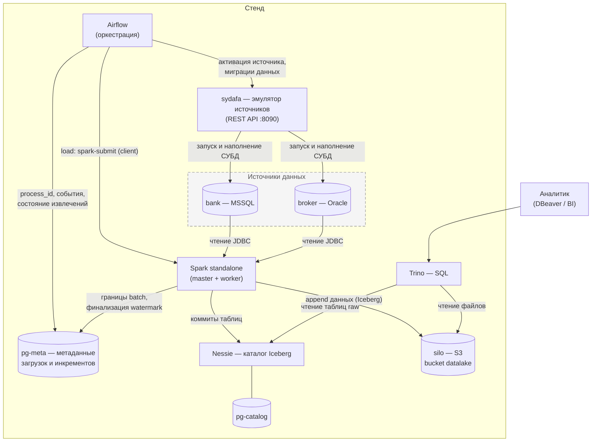

# datalake_stand — стенд КХД → DLH (raw-слой)

Локальный docker-compose стенд корпоративного хранилища данных: Airflow
оркестрирует загрузку таблиц из реляционных источников (MSSQL, Oracle) в
**raw-слой** озера на Iceberg. Raw-слой — точное зеркало таблиц источника «AS IS»
плюс технические колонки загрузки: без бизнес-логики, без преобразований, без
отбора колонок. Добавление новой таблицы в озеро — одна строка в манифесте
пайплайна и регенерация DAG-ов. Обработка данных (слои ods/dds/dma) строится
поверх raw в будущих этапах и raw при этом не меняется. Работа с данными —
SQL через Trino (DBeaver, BI) и Spark.

Документация состоит из пяти разделов: архитектура стенда, работа со стендом,
эмуляция источников, логика работы datalake, тестирование.

Дополнительно в репозитории:

- [`demo/scenario.md`](demo/scenario.md) — пошаговый сценарий демонстрации стенда
  с готовыми SQL-запросами и JSON-запросами к API;
- [`backlog.md`](backlog.md) — отложенные задачи (изоляция Spark drivers,
  гарантии полноты инкрементальной загрузки).

**Содержание**

1. [Архитектура стенда](#1-архитектура-стенда)
2. [Работа со стендом](#2-работа-со-стендом)
3. [Эмуляция источников (sydafa)](#3-эмуляция-источников-sydafa)
4. [Логика работы datalake](#4-логика-работы-datalake)
5. [Тестирование стенда](#5-тестирование-стенда)

---

## 1. Архитектура стенда

### 1.1. Назначение и ключевые решения

Стенд демонстрирует контур загрузки данных production-архитектуры DLH:

- **Слой = каталог.** Каждый слой озера — отдельный warehouse в Nessie и
  отдельный каталог в движках (`raw` сейчас; `ods`, `dds`, `dma` — будущие).
  Движки адресуют таблицы как `каталог.схема.таблица`, поэтому слой занимает
  слот каталога: `raw.bank.retail_bank__clients`.
- **Append-only.** Каждая загрузка дописывает новую порцию строк; строки в raw
  никогда не обновляются и не удаляются на месте. Полная история всех загрузок
  сохраняется как данные. Семантика — at-least-once: сбой после фиксации данных,
  но до фиксации водяного знака может привести к повторной записи порции при
  повторе (см. раздел 4.6).
- **Устойчивость к эволюции схемы источника.** Новые колонки источника
  добавляются в таблицу озера автоматически, исчезнувшие заполняются NULL,
  изменение типа не проходит молча (см. раздел 4.4).
- **Два контура.** Контур A — сам датахаб (Airflow, Spark, Nessie, Trino, silo,
  pg-catalog, pg-meta). Контур B — подключаемый эмулятор источников sydafa,
  который поднимает и наполняет СУБД-источники; в production вместо него были бы
  реальные базы.

### 1.2. Состав инстансов

| Инстанс | Образ/версия | Назначение |
|---|---|---|
| `sydafa` | `sydafa:latest` | Эмулятор источников: REST API для активации СУБД, транзакционных миграций схемы/данных и генерации синтетических данных (раздел 3) |
| `sydafa-src-mssql-bank` | `mcr.microsoft.com/mssql/server:2022-CU27` | Источник **bank** (MSSQL 2022, база `sydafa`, схема `retail_bank`); запускается sydafa лениво, по требованию |
| `sydafa-src-oracle-broker` | `gvenzl/oracle-free:23-slim-faststart` | Источник **broker** (Oracle Free 23, PDB `sydafa`, схема `trading_core`); запускается sydafa лениво |
| `spark-master` / `spark-worker` | `tabulario/spark-iceberg:3.5.5_1.8.1` + JDBC-драйверы MSSQL/Oracle | Spark 3.5.5 standalone-кластер; загрузка источников в Iceberg по JDBC, каталог `raw` через REST |
| `airflow-webserver` / `airflow-scheduler` / `airflow-dag-processor` | `apache/airflow:3.3.2-python3.11` (+ Spark, JDK 17, JDBC-jars) | Оркестрация: DAG-и обновления источников и DAG-и загрузки raw-слоя, LocalExecutor |
| `airflow-postgres` | `postgres:16.15` | Собственная база Airflow (метаданные DAG-ов, XCom) |
| `nessie` | `ghcr.io/projectnessie/nessie:0.99.0` | Каталог метаданных Iceberg (REST API), warehouse `raw` → `s3://datalake/raw/` |
| `pg-catalog` | `postgres:16.15` | Хранилище самого Nessie (JDBC version store) |
| `silo` + `silo-init` | `pgsty/silo` (MinIO-совместимый S3) | Объектное хранилище: bucket `datalake` (данные Iceberg); `silo-init` — одноразовое создание bucket |
| `trino` | `trinodb/trino:479` | SQL-движок над Iceberg: аналитика, проверка результатов загрузок; каталог `raw` |
| `pg-meta` | `postgres:16.15` | Операционная база фреймворка загрузки: идентификаторы процессов, события DAG-ов и тасков, состояние инкрементальных извлечений (раздел 4.6–4.7) |
| `test-runner` (профиль `test`) | `python:3.12-slim` | Одноразовый контейнер e2e-тестов; на живом стенде не запускается (раздел 5) |

### 1.3. Общая схема



Поток данных одной загрузки: Airflow выделяет `process_id` в pg-meta → будит
источник через sydafa → таск `load` отправляет spark-job в Spark → job читает
таблицу источника по JDBC, фиксирует границы извлечения в pg-meta **до**
чтения, дописывает порцию строк в Iceberg (физически — новые Parquet-файлы в
silo, метаданные таблицы — коммит в Nessie) и атомарно финализирует водяной
знак в pg-meta. Аналитик видит результат через Trino.

### 1.4. Требования к ресурсам Docker

Стенду нужен Docker-хост (для Docker Desktop — его виртуальная машина) с
**минимум 16 ГБ RAM**. Одновременно работают до двух СУБД-источников (MSSQL +
Oracle), кластер Spark, Airflow, Trino, Nessie, silo и три инстанса
PostgreSQL, а при параллельных загрузках — несколько Spark-приложений разом.
Дефолтных для Docker Desktop 8 ГБ не хватает: OOM-killer останавливает
контейнеры СУБД-источников и Trino прямо посреди загрузки (симптом — падение
load-тасков по JDBC-коннекту).

Проверка выделенной памяти:

```bash
docker info | grep "Total Memory"   # должно быть ≥ 16 GiB
```

В Docker Desktop память меняется в Settings → Resources → Memory (изменение
требует рестарта Docker).

### 1.5. Структура репозитория

| Путь | Назначение |
|---|---|
| `airflow/` | Пользовательский код оркестрации: DAG-и обновления источников (`dags/update_source_*.py`), сгенерированные DAG-и загрузки (`dags/generated/`, артефакт, в git не попадают), плагины `plugins/ingestion` (операторы и реестр pg-meta) и `plugins/migrations` (батчи операций обновления источников) |
| `spark/` | Spark-job-ы по слоям: `spark/raw/load_entity.py` — append-загрузчик одной сущности (JDBC → Iceberg) и `spark/raw/extraction.py` — типизированные позиции инкремента и диалектные SQL-кодеки |
| `trino/` | Пользовательский SQL (каркас) |
| `ingestion/` | Манифесты источников (`sources.yaml`), пайплайнов (`pipelines/**/*.yaml`), технические настройки (`settings.yaml`), библиотека валидации (`lib/`), генератор DAG-ов (`generate_dags.py`) |
| `conf/airflow` | Dockerfile и requirements образа Airflow (+ Spark, JDK, JDBC-драйверы), генератор паролей |
| `conf/spark` | Dockerfile и `spark-defaults.conf` (каталог `raw`: Nessie REST + S3FileIO в silo) |
| `conf/trino` | Конфигурация Trino: HTTPS + password-authenticator, каталог `raw` |
| `conf/silo` | `init-bucket.sh` — создание bucket `datalake` |
| `conf/pg-meta` | `init/01_ingestion.sql` — DDL операционной схемы загрузки (применяется контейнером при первом старте на пустом томе) |
| `conf/sydafa` | `sources.json` — декларативный манифест источников: схема таблиц, правила генерации, внешние порты |
| `demo/` | Сценарий демонстрации стенда |
| `test/` | e2e-тесты (`test.sh`, `run_flow.py`, `check_extraction.py`, `schema_evolution.py`, `temporal_extraction.py`) и юнит-тесты (`unit/`) |
| `docker-compose.yaml` | Каркас стенда (проект `dlh-poc`) |
| `.env` | `STAND_USER` / `STAND_PASSWORD` (по умолчанию `admin123` / `admin123`) |

Каталоги `airflow/`, `spark/`, `trino/` — пользовательский код: compose
монтирует их в контейнеры (`plugins` — только чтение), в git через
`.gitignore` попадают лишь явно разрешённые поддеревья.

---

## 2. Работа со стендом

### 2.1. Запуск и остановка

Предусловия: Docker + Docker Compose, ≥16 ГБ RAM для Docker (раздел 1.4),
склонированный репозиторий с `.env`. Интернет нужен только для первой сборки
образов — повторные запуски работают офлайн.

```bash
docker compose up -d --build        # сборка (первый раз) и запуск всех сервисов
docker compose ps                   # статус сервисов
docker compose logs -f <сервис>     # логи конкретного сервиса
docker compose stop                 # остановка без удаления контейнеров
docker compose start                # повторный запуск остановленного стенда
docker compose down                 # остановка и удаление контейнеров и сетей (тома остаются)
```

Полный сброс с потерей всех данных (`down -v` удаляет тома: данные озера,
источников, метаданные Airflow и pg-meta):

```bash
docker compose down -v --remove-orphans
```

После `down -v` стенд поднимается с нуля: источники пересоздаются по
`conf/sydafa/sources.json`, pg-meta инициализируется DDL из `conf/pg-meta/init/`.

Изменения кода в `airflow/`, `spark/`, `trino/`, `conf/` подхватываются
пересозданием контейнеров; изменение Dockerfile/requirements требует пересборки
(`docker compose up -d --build`).

### 2.2. Порты

| Сервис | Порт на хосте | Примечание |
|---|---|---|
| sydafa (REST, Swagger UI) | 8090 | без авторизации |
| nessie (Iceberg REST) | 19120 | движки используют внутреннее имя; наружу опубликован для отладки |
| silo: S3 API / веб-консоль | 9000 / 9001 | |
| spark-master UI | 8080 | порт 7077 (master RPC) тоже опубликован |
| spark-worker UI | 8081 | |
| trino (HTTPS) | 8443 | внутренний HTTP 8080 не опубликован — им пользуется только Airflow внутри сети |
| airflow webserver | 8089 | |
| bank, MSSQL (при активации) | 14330 | внешний порт источника из `sources.json` |
| broker, Oracle (при активации) | 15211 | внешний порт источника из `sources.json` |

Не опубликованы наружу (доступны только внутри сети стенда): `pg-catalog`,
`pg-meta`, `airflow-postgres` — см. раздел 2.5 про доступ к pg-meta.

### 2.3. Веб-интерфейсы

| Сервис | URL | Логин/пароль |
|---|---|---|
| Airflow | http://localhost:8089 | `admin123` / `admin123` |
| Spark Master UI | http://localhost:8080 | без авторизации |
| Spark Worker UI | http://localhost:8081 | без авторизации |
| silo, веб-консоль | http://localhost:9001 | `admin123` / `admin123` |
| sydafa, Swagger UI | http://localhost:8090/docs | без авторизации |

В Airflow UI видны шесть DAG-ов: два обновления источников
(`update_source_bank`, `update_source_broker`) и четыре загрузки raw-слоя
(`ingest__rdbms__bank__main`, `ingest__rdbms__bank__refs`,
`ingest__rdbms__broker__main`, `ingest__rdbms__broker__refs`). Запуск — кнопка
треугольника справа (DAG-и не на паузе, расписания нет — только ручной запуск).

### 2.4. Подключение к Trino из DBeaver

Драйвер «Trino» встроен в DBeaver:

- Host: `localhost`, Port: `8443`;
- Use SSL: да (Trino работает по HTTPS с самоподписанным сертификатом);
- Catalog/Database: `raw`;
- Username/Password: `admin123` / `admin123` (password-authenticator, конфиг в
  `conf/trino/`);
- Driver properties: `SSL=true;SSLVerification=NONE`;
- JDBC URL: `jdbc:trino://localhost:8443/raw?SSL=true&SSLVerification=NONE`.

Обзор озера и типовые запросы к raw-таблицам — в разделах 4.3 и 4.4.

### 2.5. Доступ к pg-meta

`pg-meta` намеренно не опубликован на хост: это внутренняя операционная база
фреймворка загрузки. Просмотр артефактов загрузок — через psql в контейнере:

```bash
docker compose exec pg-meta psql -U admin123 -d meta -c '\dt ingestion.*'
docker compose exec pg-meta psql -U admin123 -d meta -c \
  "SELECT * FROM ingestion.extraction_batches ORDER BY batch_id DESC LIMIT 10;"
```

Состав таблиц и смысл каждой колонки — раздел 4.6–4.7.

### 2.6. Учётные данные

В `.env` заданы только `STAND_USER` и `STAND_PASSWORD` (по умолчанию оба
`admin123`); из них выводятся пароли Airflow, Trino, silo и трёх PostgreSQL.
Пароль silo должен быть не короче 8 символов. Технические ключи (TLS, JWT) не
заменяются этим паролем. Изменение env не меняет роли в уже инициализированных
томах Postgres — для тестового стенда допустима переинициализация `down -v`.

- **Источники СУБД (MSSQL, Oracle)**: `sydafa` / `sydafa` — читатель с правами
  только `SELECT`; используется Spark-загрузчиком и подключениями из DBeaver
  (раздел 3.3). Административный доступ извне закрыт.
- **Trino**: `admin123` / `admin123` — SQL-запросы (CLI, DBeaver, BI).
- **Airflow UI**: `admin123` / `admin123`.
- **silo (консоль и S3 API)**: `admin123` / `admin123`.
- **PostgreSQL стенда (pg-catalog, pg-meta, airflow-postgres)**: `admin123` /
  `admin123` (наружу не опубликованы).
- Без авторизации: Spark Master/Worker UI, sydafa Swagger UI.

---

## 3. Эмуляция источников (sydafa)

### 3.1. Что такое sydafa

**sydafa** (Synthetic Data Factory & DB Orchestrator) — автономный сервис из
отдельного репозитория [georgekochergin/sydafa](https://github.com/georgekochergin/sydafa).
Полная документация, спецификация REST API и семантика генераторов — там; здесь
только то, что нужно для работы со стендом.

На стенде sydafa играет роль «настоящих» источников данных:

- лениво оркеструет контейнеры СУБД `sydafa-src-mssql-bank` /
  `sydafa-src-oracle-broker` через Docker API (данные — в named volume; пока
  источник не нужен, контейнер СУБД остановлен и не потребляет память);
- создаёт рабочую базу/PDB `sydafa` и читателя `sydafa` / `sydafa` (только
  чтение);
- генерирует синтетические данные по декларативным правилам (генераторы
  `sequence`, `faker`, `choice`, `random_decimal`, `random_date`, `date_offset`,
  инвариант `cumulative_balance`);
- выполняет транзакционные батчи DDL+DML «всё или ничего» — это механизм
  «жизни» источников: вставки, обновления, удаления, эволюция схемы.

Конфигурация источников стенда: `conf/sydafa/sources.json` — декларативный
источник правды по топологии (схемы таблиц, первичные и внешние ключи, правила
генерации, внешний порт `external_port` для подключения с хоста).

### 3.2. Активация источника и подключение из DBeaver

СУБД-источник по умолчанию остановлен. Перед подключением из DBeaver его нужно
поднять по TTL (после истечения TTL sydafa сам аккуратно остановит контейнер):

1. Откройте Swagger UI: http://localhost:8090/docs.
2. Выполните `POST /sources/{bank|broker}/activate?ttl_minutes=20` («Try it
   out» → «Execute»). Максимум TTL — 30 минут.
3. Из ответа возьмите объект `connection` — готовые параметры подключения:

```json
{
  "type": "mssql",
  "host": "localhost",
  "port": 14330,
  "database": "sydafa",
  "user": "sydafa",
  "password": "sydafa",
  "jdbc_url": "jdbc:sqlserver://localhost:14330;databaseName=sydafa;..."
}
```

4. Подключитесь в DBeaver (реквизиты везде `sydafa` / `sydafa`):
   - **bank, MSSQL**: драйвер SQL Server, host `localhost`, port `14330`,
     database `sydafa` (схема `retail_bank`);
   - **broker, Oracle**: драйвер Oracle, host `localhost`, port `15211`,
     service name `sydafa` (схема `trading_core`), SID оставьте пустым.
5. Ранний доступ к СУБД изнутри сети стенда (для сервисов): внутренние имена
   `sydafa-src-mssql-bank:1433`, `sydafa-src-oracle-broker:1521` — именно их
   использует Spark.

В каждой таблице источника sydafa ведёт служебную колонку `_batch_id bigint` —
номер партии наполнения; она растёт при вставках и служит колонкой инкремента
для таблицы `transactions` (раздел 4.6).

Освободить память принудительно: `POST /sources/{source}/deactivate`.

### 3.3. Основные эндпоинты

| Метод | Путь | Назначение |
|---|---|---|
| GET | `/health` | Готовность API sydafa (не означает, что СУБД запущена) |
| GET | `/sources` | Список сконфигурированных источников |
| GET | `/sources/{source}` | Метаданные источника: таблицы, статус, `connection` (СУБД не будит) |
| GET | `/sources/{source}/schema` | Живая схема: таблицы, колонки, типы, генераторы, PK/FK |
| GET | `/sources/{source}/status` | Состояние контейнера (idle/running), остаток TTL |
| POST | `/sources/{source}/activate` | Запуск СУБД + TTL (`?ttl_minutes=20`; сам будит базу) |
| POST | `/sources/{source}/deactivate` | Принудительная остановка СУБД |
| POST | `/sources/{source}/migrate` | Транзакционный батч DDL+DML «всё или ничего» (будит базу) |
| GET/PUT/DELETE | `/sources/{source}/rules/{entity_fqn}` | Профиль генераторов таблицы: `columns` (колонка → генератор) и `invariants`; PUT перезаписывает профиль целиком |

Операции `migrate` (дискриминатор `op`): схема — `create_schema`,
`rename_schema`, `drop_schema`; таблицы — `create_table`, `rename_table`,
`transfer_table`, `drop_table`; колонки — `add_column`, `rename_column`,
`drop_column`; данные — `append` (строк `rows`), `update` (`predicate` + `set`
+ `limit`), `delete` (`predicate`/`limit`/`cascade`), `truncate`. Готовые
примеры батчей — в `demo/scenario.md`.

### 3.4. DAG-и обновления источников

`update_source_bank` и `update_source_broker` (ручной запуск) — «оживление»
данных между раундами загрузки. Один таск `migrate` (`SydafaMigrateOperator`
пакета `sydafa-airflow`) применяет транзакционный батч операций из
`airflow/plugins/migrations/{bank,broker}.json`:

- вставки: +100 clients, +100 accounts, +1000 deals, +25000 transactions;
- каскадное удаление 50 случайных сделок (`cascade: true` — вместе со
  ссылающимися транзакциями);
- точечные обновления справочников (10 clients, 10 accounts, 50 deals — статус
  или категория).

Именно после запуска этих DAG-ов инкрементальные загрузки видят новую дельту, а
снапшотные — выросшие таблицы.

### 3.5. Добавление источника и сброс к манифесту

Новый источник: добавить описание в `conf/sydafa/sources.json` (тип `mssql` /
`oracle`, свободный `external_port`, при желании — `operations` первичного
наполнения) и перезапустить `docker compose restart sydafa`. Ранее
инициализированные базы не затрагиваются; наполнение новой — при первом
`activate`/`migrate`.

Сброс источников строго по `sources.json` — `docker compose down -v` (полный
сброс стенда, см. 2.1).

---

## 4. Логика работы datalake

### 4.1. Манифесты и генерация DAG-ов

DAG-и загрузки не пишутся руками и не строятся динамически при парсинге
Airflow: скрипт `ingestion/generate_dags.py` статически превращает YAML-манифесты
в готовые Python-файлы в `airflow/dags/generated/` (каталог в git не попадает).
В сгенерированном файле каждый таск, TaskGroup и зависимость — литерал; YAML не
читается и соединения не разрешаются при парсинге (учётные данные берутся из
Airflow Connections во время исполнения таска). Это заготовка будущего CI/CD:
в CI генератор запускается автоматически, локально — вручную (имитация CI/CD на
демо).

```bash
python3 ingestion/generate_dags.py            # (пере)генерация DAG-ов
python3 ingestion/generate_dags.py --check    # расхождение сгенерированного с манифестами → exit 1
```

Генератор обходит `ingestion/pipelines/` рекурсивно; один YAML-файл = один DAG.
Идентификатор DAG и имя файла: `ingest__<type>__<source_id>[__<стебель_файла>]`
(постфикс опускается, если имя файла совпадает с `source_id`): так четыре
манифеста `{bank,broker}/{main,refs}.yaml` дают четыре DAG-а. Ошибки
конфигурации выявляются на генерации, до попадания в Airflow: неизвестные ключи
на любом уровне, дубликаты FQN, коллизии DAG ID и коллизии целевых таблиц
(сообщение называет оба конфликтующих файла). Устаревшие сгенерированные файлы
удаляются, чужие файлы не перезаписываются.

**`ingestion/sources.yaml`** — реестр источников (ключ — `source_id`):

| Параметр | Тип | Обязателен | Описание |
|---|---|---|---|
| `type` | `rdbms` | да | Вид источника: определяет правила валидации FQN и путь чтения. `kafka` зарезервирован на будущее и пока отвергается |
| `airflow_conn_id` | string | да | Airflow Connection с реквизитами источника; схема соединения (например `mssql://`) проверяется на соответствие типу во время исполнения |

**Манифест пайплайна** (`pipelines/**/*.yaml`), ключи верхнего уровня:

| Параметр | Тип | Обязателен | По умолчанию | Описание |
|---|---|---|---|---|
| `source_id` | string | да | — | Должен существовать в `sources.yaml`; задаёт схему-неймспейс целевых таблиц |
| `schedule` | string \| null | нет | `null` (ручной запуск) | Расписание Airflow |
| `catchup` | bool | нет | `false` | Догоняющие запуски Airflow |
| `tags` | list[string] | нет | `[]` | Теги DAG-а |
| `entities` | list | да | — | Непустой список сущностей (см. ниже) |

**Ключи сущности:**

| Параметр | Тип | Обязателен | По умолчанию | Описание |
|---|---|---|---|---|
| `fqn` | string | да | — | `<схема>.<таблица>` источника, ровно два фрагмента; преобразуется в имя целевой таблицы по правилам именования (раздел 4.3) |
| `incremental` | mapping | нет | полный снапшот | Переключает сущность в инкрементальный режим: `source_column` — колонка инкремента (строчный идентификатор); `lookback.size` — неотрицательное число, `lookback.unit` — `h`/`d`. Для целочисленных колонок `unit` запрещён; для date допустим только `d`; для timestamp обязателен всегда, когда блок `lookback` указан (даже при `size: 0`) |
| `spark.parallelism` | bool | нет | `true` | `false` — читать источник одной JDBC-партицией без разведки ключей (раздел 4.5) |
| `airflow.pool.name` | string | нет | `default_pool` | Пул load-таска; пользовательский пул должен заранее существовать в Airflow |
| `airflow.pool.slots` | int | нет | `1` | Вес load-таска в пуле |

**`ingestion/settings.yaml`** — общие технические настройки: сейчас один ключ
`spark.jdbc.num_partitions` (положительное целое, по умолчанию на стенде `4`) —
число JDBC-партиций параллельного чтения (раздел 4.5). Значение инлайнится в
сгенерированный DAG.

Текущие манифесты стенда (демо-набор): в `main.yaml` каждого источника —
`transactions` (инкремент по `_batch_id`) и `deals` (снапшот); в `refs.yaml` —
`clients` и `accounts` (снапшоты, у всех демо-таблиц кроме transactions
JDBC-параллелизм отключён).

### 4.2. Структура сгенерированного DAG-а

```text
DAG ingest__rdbms__bank__main
│  schedule=None, catchup=False, max_active_runs=1, tags из YAML,
│  params: force_full_snapshot_fqns (список FQN этого DAG), reason (строка),
│  колбэки успеха/провала → события END/FAILED в pg-meta
│
├── generate_process_id   валидация conf запуска; выделение process_id (XCom)
└── activate_source       SydafaActivateOperator: поднять СУБД, TTL 15 минут
    └── TaskGroup "ingest_group"                       (сущности параллельно)
        ├── TaskGroup "load_retail_bank__transactions" (одна сущность)
        │   ├── log_start   событие START в pg-meta
        │   ├── load        IngestAppendOperator → spark/raw/load_entity.py
        │   └── log_end     событие END + публикация Asset
        └── TaskGroup "load_retail_bank__deals" ...
```

Зависимости: `generate_process_id >> activate_source >> ingest_group`; внутри
группы сущности независимы, внутри сущности — `log_start >> load >> log_end`.
`max_active_runs=1` сериализует запуски одного DAG-а — «последний снапшот» и
водяные знаки однозначны.

Таски:

- **`generate_process_id`** (`GenerateProcessIdOperator`) — прежде всего
  валидирует конфигурацию ручного запуска (см. ниже); затем получает
  `process_id`: одна строка START на DAG-запуск в `airflow_dagruns_log`
  (идемпотентно: повтор таска и очистка возвращают тот же идентификатор, новый
  запуск DAG-а — новый). Идентификатор передаётся через XCom.
- **`activate_source`** (`SydafaActivateOperator`, пакет `sydafa-airflow`) —
  будит СУБД источника через REST sydafa с TTL 15 минут, чтобы последующий
  JDBC-читатель не упёрся в спящий контейнер.
- **`log_start` / `log_end`** (`TableLogOperator`) — события жизненного цикла
  сущности в `airflow_tasks_log`; `log_end` публикует Asset
  `raw://<source_id>/<fqn>` — на них смогут подписываться DAG-и следующих
  слоёв.
- **`load`** (`IngestAppendOperator`, наследник `SparkSubmitOperator`,
  client-mode, job `spark/raw/load_entity.py`) — исполнитель загрузки. Во время
  исполнения: разрешает Airflow Connection источника в JDBC URL (проверяя схему
  соединения против `type`), берёт `process_id` из XCom, передаёт spark-job
  параметры сущности (включая режим, lookback, пул) и реквизиты pg-meta через
  переменные окружения (никаких паролей в аргументах командной строки).

**Пул `ingest_loads`.** Все load-таски всех ingest-DAG-ов делят один пул на
4 слота (создаётся сервисом `airflow-init`); `transactions` занимает 2 слота,
остальные загрузки — по 1. Пул ограничивает количество одновременно работающих
Spark-приложений (каждое — отдельный driver + executors, что дорого для
Docker-машины), но не выделяет им CPU/память.

**Ручной полный снимок.** Запуск main-DAG-а можно параметризовать
(кнопка запуска с конфигурацией или REST API):

```json
{"force_full_snapshot_fqns": ["retail_bank.transactions"], "reason": "Проверка полноты"}
```

Выбранная таблица читается целиком (водяной знак сохраняется), остальные — по
манифесту. Валидация до активации источника: FQN только из этого DAG, без
дублей, `reason` обязателен и непуст.

### 4.3. Таблицы raw-слоя: структура и наполнение

**Именование.** Полное имя сущности источника кодируется: каждая точка → `__`.
`retail_bank.clients` → таблица `retail_bank__clients` в схеме `bank`
(источник) каталога `raw`: полное имя `raw.bank.retail_bank__clients` (каталог —
слой, схема — источник).

**Структура таблицы.** Колонки — точное зеркало схемы источника на момент
чтения — плюс три технические колонки:

| Колонка | Тип | Смысл |
|---|---|---|
| `__load_dttm` | `timestamp_ltz` | Момент загрузки (одно значение на порцию); аналитическое измерение времени; колонка партиционирования |
| `__process_id` | `bigint` | Идентификатор DAG-запуска из pg-meta; точная связь порции с запуском и журналом |
| `__batch_id` | `bigint` | Идентификатор логического извлечения сущности (одна таблица × один запуск DAG); общий для попыток-повторов |

Партиционирование фиксировано фреймворком: `days(__load_dttm)` — дневные
партиции по границам UTC-дня. Первая загрузка создаёт таблицу DDL-ом по
фактически прочитанной схеме источника (колонки источника никогда не
перечисляются в YAML):

```sql
CREATE TABLE raw.bank.retail_bank__clients (
  `client_id` bigint, `full_name` string, ...,
  `__load_dttm` timestamp_ltz, `__process_id` bigint, `__batch_id` bigint
) USING iceberg
PARTITIONED BY (days(`__load_dttm`))
TBLPROPERTIES ('write.spark.accept-any-schema'='true')
```

**Режимы наполнения:**

- **Полный снапшот** (по умолчанию) — каждый запуск читает всю таблицу
  источника и дописывает её полное состояние новой порцией. Текущее состояние
  источника = последняя порция; удаления на источнике отражаются (удалённые
  строки отсутствуют в новом снапшоте, но остаются в истории).
- **Инкрементальный** (`incremental.source_column`) — каждый запуск читает окно
  новых строк по колонке инкремента. Первая загрузка без сохранённого водяного
  знака — первичное наполнение (вся таблица, без нижней границы). Подробно —
  раздел 4.6.

Каждая загрузка = одна порция = пара (`__process_id`, `__load_dttm`); порция
однозначно идентифицируется в данных, в реестре pg-meta и в логах Airflow.

**Типовые запросы (Trino):**

```sql
SHOW TABLES FROM raw.bank;

DESCRIBE raw.bank.retail_bank__clients;

SELECT count(*) FROM raw.bank.retail_bank__clients;

SELECT * FROM raw.bank.retail_bank__clients
WHERE __load_dttm = (SELECT max(__load_dttm) FROM raw.bank.retail_bank__clients);

SELECT __process_id, __batch_id, count(*) AS rows
FROM raw.bank.retail_bank__clients
GROUP BY 1, 2 ORDER BY 1;

SELECT count(*) FROM raw.bank.retail_bank__transactions WHERE __process_id = 42;
```

`__load_dttm` — `timestamp_ltz` (абсолютный момент); партиции следуют UTC-дням,
а «сегодня» — календарное понятие. Сравнивайте с зоной:

```sql
SET TIME ZONE 'Europe/Moscow';
SELECT * FROM raw.bank.retail_bank__clients
WHERE __load_dttm >= current_date
  AND __load_dttm < current_date + INTERVAL '1' DAY;
```

Литералы без зоны (`TIMESTAMP '2026-10-26 00:00:00'`) интерпретируются в зоне
сессии и молча сдвигают окно на часы — избегайте; пишите
`TIMESTAMP '...' AT TIME ZONE 'UTC'`.

**Гарантии и границы.** Данные озера и метаданные pg-meta фиксируются в разных
системах: сбой после коммита Iceberg, но до финализации водяного знака приведёт
к повторной записи той же порции при повторе запуска (at-least-once, не
exactly-once). Повтор диапазона допустим и не считается ошибкой; следующему
слою требуется идемпотентный merge по ключу/версии источника, а не `sum` по
raw-строкам. Пустой источник тоже создаёт raw-таблицу (проверка схемы без
строк).

### 4.4. Устойчивость к эволюции схемы источника

Схема raw-таблицы никогда не описывается вручную и не фиксируется жёстко:
загрузчик читает схему источника «как есть сейчас» и переносит её в озеро.
Три настройки Iceberg/Spark обеспечивают перенос изменений схемы без ручного
участия и без падений:

**`write.spark.accept-any-schema=true`** — свойство таблицы, задаётся один раз
в DDL при создании и действует на всех будущих писателей. По умолчанию Iceberg
строго сверяет схему записываемого DataFrame со схемой таблицы: не хватает
колонки или лишняя — запись падает. Это свойство делает проверку сопоставлением
по имени и разрешает DataFrame'у **не иметь** части колонок таблицы: в
дописываемых строках они сохраняются как NULL. Новые колонки на этом уровне
всё ещё ошибка — их добавляет вторая настройка.

**`mergeSchema=true`** — опция записи, передаётся при каждом append. Непосредственно
перед записью Iceberg сравнивает схему DataFrame со схемой таблицы и добавляет
каждую колонку DataFrame, которой таблице не хватает (эквивалент `ALTER TABLE
ADD COLUMN` внутри коммита записи). Существующие строки читают новую колонку
как NULL.

**`check-ordering=false`** — опция записи, отключает сверку **позиций** колонок.
По умолчанию Iceberg проверяет, что порядок полей записываемого DataFrame
совпадает с порядком полей таблицы. Здесь сопоставление всегда по имени:
источник свободно меняет порядок колонок, а новые колонки после слияния схем
могут оказаться в схеме таблицы после технических колонок — и это корректно
(в Iceberg колонки идентифицируются field id и именем, а не позицией). Проверка
типов при этом сохраняется.

Совместно это даёт полный «белый список» реакции на изменения источника:

| Изменение на источнике | Эффект в raw-таблице |
|---|---|
| добавлена колонка | автоматически добавлена (`mergeSchema`); исторические строки — NULL, новые — со значениями |
| колонка удалена | колонка в таблице сохраняется; новые строки — NULL |
| колонка переименована | распознаётся как удалить+добавить: старая колонка сохраняется (новые строки NULL), новая добавляется (история NULL) |
| изменён тип колонки | не автоматизируется: несовместимое изменение — загрузка падает сразу (честный отказ); совместимое — требует явного `ALTER TABLE` |
| изменён порядок колонок | никакого (сопоставление по имени, `check-ordering=false`) |

Граница автоматизации принципиальна: **только добавление**. Ни одно изменение
схемы не роняет запись и не теряет данные молча; удаления/переименования
оставляют след в истории (старые колонки читаются NULL у новых строк), а смена
типа — явное решение человека.

Физически каждый append пишет только новые Parquet-файлы плюс один коммит
метаданных (новый снапшот таблицы): файлы предыдущих загрузок не меняются,
более поздняя загрузка не может испортить более раннюю историю.

### 4.5. Параллелизм Spark

У пользователя без опыта Spark главное недопонимание — что «параллелизм» здесь
означает три независимых вещи. Разделим их.

**(1) Параллельное чтение источника (JDBC-партиции).** Чтение таблицы по JDBC —
один поток на партицию: Spark открывает несколько одновремененных SELECT к
СУБД, каждый читает свой диапазон строк, далее каждый диапазон обрабатывается
отдельным таском кластера. Диапазоны задаёт четвёрка параметров чтения:
`partitionColumn` (колонка, по которой режем), `lowerBound`/`upperBound`
(минимум/максимум этой колонки) и `numPartitions` (на сколько диапазонов
разбить). Например при `numPartitions=4` и диапазоне id 1..1000 каждый поток
читает `WHERE id BETWEEN ... AND ...` своего квартеля.

**Выбор колонки параллелизма — автоматический, это не настройка.** Порядок
приоритета:

1. колонка инкремента, если сущность инкрементальная (монотонный числовой
   столбец всегда безопасен для нарезки);
2. колонки первичного ключа в порядке `KEY_SEQ`;
3. колонки уникальных индексов;
4. первый кандидат подходящего типа: числовой / date / timestamp
   (строковые и GUID-колонки пропускаются);
5. не нашлось — чтение одним потоком (одна JDBC-партиция).

Кандидаты берутся из стандартного JDBC API `DatabaseMetaData` (`getPrimaryKeys`,
`getIndexInfo`, `getColumns`) — он одинаково работает в MSSQL и Oracle, в отличие
от `INFORMATION_SCHEMA`, которого в Oracle нет. Для выбранной колонки на
источнике выполняется `SELECT MIN(col), MAX(col)`; пустой диапазон — чистый
пропуск без чтения, равные границы — чтение одной партицией (нарезать диапазон
нечего). Настройка `spark.jdbc.num_partitions` из `settings.yaml` (на стенде 4)
задаёт `numPartitions`.

**Когда параллельное чтение отключается:**

- `spark.parallelism: false` у сущности — намеренно (так настроены все демо-таблицы
  кроме `transactions`): пропускаются разведка ключей и запрос MIN/MAX, чтение
  идёт одной партицией;
- temporal-инкремент (колонка типа timestamp): чтение всегда одной JDBC-партиции —
  чтобы положение инкремента прошло через кадр данных без округления до
  микросекунд Spark (раздел 4.6); распределённая запись в Iceberg при этом
  полностью сохраняется.

**(2) Параллельные загрузки сущностей.** Таски `load` разных сущностей внутри
DAG-а и разных DAG-ов исполняются параллельно; их количество сдерживает пул
Airflow `ingest_loads` (4 слота; см. раздел 4.2). Это допуск к исполнению, а не
выделение ресурсов.

**(3) Внутренние потоки Spark.** Отключение JDBC-параллелизма (одна партиция
чтения) не останавливает внутреннюю многопоточность Spark при обработке и
записи: один кадр данных всё равно пишется executor'ами кластера.

Каждая загрузка — отдельное Spark-приложение: driver работает в контейнере
`airflow-scheduler` (client-mode), executors — на `spark-worker`. В образе
Airflow используется Python 3.11, в образе Spark-кластера — Python 3.10:
JDBC/DataFrame-загрузки не запускают Python-worker'ов, но для Python UDF/RDD
потребуется выравнивание minor-версий (задача изоляции drivers — в `backlog.md`).

### 4.6. Инкрементальная загрузка

#### 4.6.1. Контракт

Инкрементальная сущность задаётся колонкой инкремента
(`incremental.source_column`) и опциональным отступом `lookback`
(`size` + `unit`). Тип колонки определяется автоматически из JDBC-метаданных и
поддерживается строго типизированно, без потерь точности:

| Семейство | Типы источника | Канонический вид позиции |
|---|---|---|
| целочисленные (знаковые) | `smallint`, `int`, `bigint`, `decimal(p,0)` | целое число: `-10`, `0`, `12345` |
| дата | `date` (MSSQL) | `2026-10-26` |
| локальный момент | MSSQL `datetime`/`datetime2(p)`, Oracle `DATE`, Oracle `TIMESTAMP(p)` | `2026-10-26T12:00:00.123456` (точность 0–9 без зоны) |
| мгновенный момент (UTC) | MSSQL `datetimeoffset(p)`, Oracle `TIMESTAMP(p) WITH [LOCAL] TIME ZONE` | `2026-10-26T12:00:00.123456Z` |

Ограничения: Oracle `DATE` содержит время и потому считается локальным
моментом точности 0, а не датой; типы `timestamp`/`rowversion` СУБД не
поддерживаются; позиция с точностью выше микросекунд Spark не округляется —
граница читается из источника строкой специальным выражением (в Oracle
`TO_CHAR` с маской до `FF9`, в MSSQL `CONVERT` + `DATEPART(nanosecond)`), так
что суб-микросекундная точность сохраняется в водяном знаке полностью. Колонки
Oracle `TIMESTAMP WITH TIME ZONE` дополнительно нормализуются в UTC выражением
`SYS_EXTRACT_UTC` ещё на стороне источника — Spark JDBC не умеет отображать
этот тип вовсе.

Правила lookback: для целочисленных колонок `unit` запрещён (отступ — просто
число); для date допустим только `d`; для timestamp `unit` (`h`/`d`) обязателен
всегда, когда блок `lookback` присутствует в YAML, даже при `size: 0`. Если
отступ приводит к выходу за минимум типа, нижняя граница не отбрасывается, а
снимается (читается всё от начала — безопаснее потерять производительность,
чем строки).

Окно чтения регулярной загрузки строгое: `lower < col AND col <= upper`, где
`upper` — максимум колонки источника, зафиксированный **до** чтения, а
`lower` — сохранённый водяной знак минус lookback. Загрузка-первичное
наполнение (водяного знака ещё нет) читает всю таблицу без нижней границы и не
применяет lookback. Ручной полный снимок (`force_full_snapshot_fqns`) читает
всё без границ и **сохраняет** водяной знак нетронутым. NULL в колонке
инкремента блокирует регулярную загрузку (явная ошибка); ручной полный снимок
читает и NULL-строки. Регрессия максимума источника ниже сохранённого водяного
знака отвергается: это признак сброса источника, требующего явного решения.

#### 4.6.2. Жизненный цикл загрузки

Загрузкой управляет реестр в pg-meta (`airflow/plugins/ingestion/registry.py`).
Ключевая идея: **границы извлечения фиксируются до чтения** и переживают
повторы, а водяной знак двигается только атомарно с закрытием партии.

1. **План.** Driver spark-job читает состояние сущности и, если для этого
   DAG-запуска партия ещё не создана, запрашивает у источника максимум колонки
   инкремента и вставляет строку `extraction_batches` со статусом `PLANNED` и
   замороженными границами. Повтор того же DAG-запуска (retry таска, очистка)
   возвращает существующую партию с прежними границами — окно не «плывёт»
   между попытками.
2. **Пустое окно без запуска Spark.** Если замороженные границы доказывают, что
   новых строк нет (регулярная партия с нулевым lookback, у которой нижняя
   граница равна верхней), партия сразу закрывается с `row_count=0` и
   `attempt_count=0` — Spark-чтение источника не выполняется вовсе.
3. **Исполнение.** `start_batch` переводит партию в `RUNNING` (счётчик попыток
   +1) и читает окно источника. Прочитанное положение инкремента (точный
   максимум) берётся из кадра данных.
4. **Финализация.** Одной транзакцией pg-meta: обновить водяной знак (не
   откатываясь назад — типизированное сравнение) и закрыть партию `SUCCEEDED`,
   с проверкой `AND revision = expected` (compare-and-set). Занятая ревизия
   означает конкурирующего исполнителя — транзакция откатывается целиком.
5. **Сбой.** Отдельной короткой транзакцией партия помечается `FAILED` с
   текстом ошибки; состояние (водяной знак) не меняется. Повтор начинается
   снова с шага 2/3 той же партии.

Порядок блокировок фиксирован (сначала состояние, потом партия) — стабильные
блокировки при конкуренции. Уже успешная партия идемпотентна: повторная
финализация и повтор чтения ничего не меняют (данные могли быть дописаны —
at-least-once, раздел 4.3).

#### 4.6.3. `extraction_state` — состояние сущности

Одна строка на пару (источник, сущность); первичный ключ `(source_id,
entity_fqn)`.

| Колонка | Тип | Смысл |
|---|---|---|
| `source_id` | text, PK | Идентификатор источника (`bank`, `broker`) |
| `entity_fqn` | text, PK | Полное имя сущности (`retail_bank.transactions`) |
| `configured_mode` | text | Заданный манифестом режим: `incremental` или `full_snapshot` (у снапшотных сущностей строка создаётся при первой загрузке и хранит только факт контракта) |
| `incremental_column` | text | Имя колонки инкремента (NULL для снапшота); смена значения = смена контракта, требует миграции |
| `incremental_type` | text | Типизированный вид позиции: `bigint`, `decimal(18,0)`, `date`, `timestamp_local(6)`, `timestamp_instant(7)` … |
| `watermark` | text | Каноническая позиция последней успешной загрузки (NULL до первичного наполнения); текст хранит позицию без потерь любой точности |
| `revision` | bigint | Внутренняя ревизия состояния; инкрементируется при каждой финализации и миграции, участвует в CAS-проверках |
| `last_batch_id` | bigint | Ссылка на последнюю успешную партию (FK на `extraction_batches`, отложенная проверка) |
| `updated_at` | timestamptz | Момент последнего изменения строки |

CHECK-ограничение связывает режим и поля: у `incremental` колонка и тип
обязательны, у `full_snapshot` — колонка, тип и водяной знак обязаны быть NULL.

#### 4.6.4. `extraction_batches` — партии извлечений

Одна строка на сущность × DAG-запуск; уникальность `(dag_id, run_id,
source_id, entity_fqn)` — идентичность партии, стабильная между попытками.

| Колонка | Тип | Смысл |
|---|---|---|
| `batch_id` | bigserial, PK | Идентификатор партии; попадает в колонку `__batch_id` raw-строк |
| `process_id` | bigint | Идентификатор DAG-запуска (та же последовательность, что и `__process_id`) |
| `dag_id`, `run_id` | text | Принадлежность DAG-запуску |
| `source_id`, `entity_fqn` | text | Сущность; FK на `extraction_state` |
| `target_table` | text | Целевая raw-таблица |
| `mode` | text | Режим исполнения: `incremental` / `full_snapshot` |
| `reason` | text | Почему этот режим: `bootstrap` (первичное наполнение), `regular` (очередное окно), `manual_full` (ручной полный снимок) |
| `incremental_column`, `incremental_type` | text | Снимок контракта инкремента на момент партии |
| `expected_revision` | bigint | Ревизия состояния, которую партия вправе финализировать (для CAS) |
| `watermark_before` | text | Водяной знак до партии |
| `lookback_size`, `lookback_unit` | numeric / text | Применённый отступ |
| `lower_bound`, `upper_bound` | text | Замороженные границы окна чтения (NULL — границы нет: первичное наполнение, ручной снимок) |
| `empty_at_plan` | boolean | Источник был пуст в момент планирования (для первичного наполнения: флаг «источник пуст», окно закрывается без чтения) |
| `status` | text | `PLANNED` → `RUNNING` → `SUCCEEDED` / `FAILED` |
| `attempt_count` | int | Число запусков исполнения (0 у партии, закрытой без чтения) |
| `row_count` | bigint | Дописано строк (заполняется при успехе) |
| `observed_max` | text | Точный максимум колонки инкремента в прочитанном окне |
| `watermark_after` | text | Водяной знак после партии |
| `reason_text` | text | Обоснование ручного полного снимка (обязателен и непуст для `manual_full`) |
| `last_error` | text | Текст последней ошибки (санитизированный, без секретов) |
| `created_at`, `finished_at` | timestamptz | Моменты планирования и завершения |

Семейство CHECK-ограничений кодирует инварианты жизненного цикла: регулярная
инкрементная партия обязана иметь `watermark_before`; первичное наполнение —
полный режим без нижней границы; ручной снимок — без границ и с непустой
причиной; у `SUCCEEDED` заполнены результат и время завершения; у незакрытых
партий колонки результата пусты.

#### 4.6.5. Смена контракта и ручные миграции

Смена/удаление колонки инкремента или её типа — смена контракта: очередная
загрузка честно отклоняется, пока состояние не мигрировано. Процедура (кратко):
остановить DAG и исполнителей → в одной транзакции pg-meta под блокировкой
строки проверить старый контракт, записать аудит в `extraction_state_migrations`
(старое/новое значение каждого поля, исполнитель, причина), обновить режим /
колонку / тип, сбросить водяной знак, поднять ревизию → изменить YAML и
регенерировать DAG → следующий запуск выполняет первичное наполнение по новому
контракту. Историю raw не очищать; несовместимый тип в raw-схеме — отдельная
миграция схемы. Изменение только lookback миграции не требует. DDL pg-meta
применяется контейнером при первом старте на пустом томе; смена DDL требует
переинициализации тома pg-meta (для тестового стенда — `down -v`).

Гарантии полноты инкремента (поздние транзакции за окном, изменения старых
строк, удаления) описаны в `backlog.md`, задача 2 — это осознанное ограничение
батч-инкремента, закрываемое CDC или сверками.

### 4.7. База метаданных pg-meta: остальные объекты

`pg-meta` (база `meta`, схема `ingestion`) — выделенная операционная база
фреймворка: последовательность идентификаторов не может жить в озере (нет
атомарного инкремента на объектном хранилище), а операционные метаданные
должны переживать недоступность озера. Каталог Iceberg (pg-catalog) и база
Airflow — отдельные инстансы. DDL — `conf/pg-meta/init/01_ingestion.sql`.

**`ingestion.process_id_seq`** — последовательность идентификаторов процессов.
Каждый DAG-запуск любого ingest-DAG-а берёт `nextval` один раз
(`get_or_create`: строка START с частичным уникальным индексом по `(dag_id,
run_id) WHERE status='START'` — конкурентные повторы и очистка таска получают
тот же идентификатор, а не новый). Это значение становится `__process_id` всех
порций запуска.

**`ingestion.airflow_dagruns_log`** — журнал DAG-запусков (append-only):
`process_id`, `dag_id`, `run_id`, `execution_date`, `ts`, `status` (`START` —
из `generate_process_id`; `END`/`FAILED` — колбэки DAG-а). Текущий статус
запуска — последнее событие; длительность — разность `ts`.

**`ingestion.airflow_tasks_log`** — журнал тасков (append-only): `process_id`,
`source_id`, `entity_fqn`, `datalake_table`, `ts`, `status` (`START` / `END` —
`log_start`/`log_end`; `FAILED` — колбэк неудачи `load`).

**`ingestion.extraction_state_migrations`** — аудит ручных миграций контракта
инкремента: старая/новая ревизия (обязательно +1), режим, колонка, тип и водяной
знак до/после, `performed_by`, `reason_text`, `created_at`.

**Запросы для просмотра артефактов** (psql, раздел 2.5):

```sql
SELECT process_id, dag_id, run_id, status, ts
FROM ingestion.airflow_dagruns_log ORDER BY id DESC LIMIT 10;

SELECT process_id, entity_fqn, datalake_table, status, ts
FROM ingestion.airflow_tasks_log ORDER BY id DESC LIMIT 20;

SELECT entity_fqn, configured_mode, incremental_column, incremental_type,
       watermark, revision, last_batch_id, updated_at
FROM ingestion.extraction_state ORDER BY source_id, entity_fqn;

SELECT batch_id, process_id, entity_fqn, mode, reason, lower_bound, upper_bound,
       status, attempt_count, row_count, watermark_after, created_at, finished_at
FROM ingestion.extraction_batches ORDER BY batch_id DESC LIMIT 15;
```

---

## 5. Тестирование стенда

За проведение тестирования агентом отвечает скилл **`e2e-testing`**
(`.agents/skills/e2e-testing/SKILL.md`): он описывает принципы, устройство
тестового контура и траблшутинг. Правило кодовой базы: любой новый или
изменённый функционал пайплайнов, операторов и интеграций сопровождается
тестами (модульными или e2e) с проверкой краевых случаев.

### 5.1. Юнит-тесты

```bash
python3 -m unittest discover -s test/unit
```

Покрывают чистые функции без стенда: валидацию манифестов и именование,
детерминизм генератора DAG-ов, парсеры аргументов загрузчика, типизированные
позиции и диалектные SQL-кодеки инкремента, реестр партий (при заданной
переменной окружения `EXTRACTION_TEST_DSN` — также интеграционные тесты
против одноразового Postgres), guard-ы стиля кода (запрет комментариев `#` в
Python) и DDL pg-meta (запрет триггеров). Нужен только Python 3.11+ на хосте.

### 5.2. Полный e2e-прогон

```bash
./test/test.sh
```

Полностью изолированный тестовый проект `dlh-test` — безопасен при
одновременно работающем живом стенде: собственное дерево файлов
(`test/.workspace/`, удаляется по завершении), собственные тома и контейнеры,
отключённая публикация портов, префикс `sydafa-test-` для СУБД-источников.
Прогон по шагам:

1. статическая валидация манифестов, миграций и DAG-ов (`run_flow.py
   --validate-manifests-only`) и юнит-тесты;
2. генерация DAG-ов генератором;
3. сборка и подъём изолированного стека;
4. в `test-runner` (`run_flow.py`): health-проверки sydafa/Trino/Airflow,
   защита от SQL-инъекций (HTTP 422), запуск DAG-ов обновления источников и
   **несколько раундов загрузки** с проверками в Trino: append-only-семантика,
   один `__process_id` на запуск, удвоение снапшотов при повторе,
   инкрементальный гейт (повторная загрузка без изменений источника не пишет
   ни одной строки), дельта после обновления источника;
5. в `airflow-scheduler` (`check_extraction.py`): инварианты реестра партий —
   заморозка границ, повторы, no-op без Spark, защита водяного знака от
   регрессии и конкурирующих исполнителей, аудит ручной миграции;
6. отдельные Spark-приложения: эволюция схемы Iceberg (add/drop/rename колонок,
   честный отказ при несовместимом типе) и контракты temporal-инкремента
   (точность до наносекунд, границы окна, lookback);
7. гашение стекa и очистка только принадлежащих тестовому контуру
   контейнеров/томов (в т.ч. при неудаче — с выгрузкой логов Airflow в
   `TEST_FAILURE_LOG_DIR`).

Критерий: `FAIL=0`, exit-code `0`. Не допускается сдача задач при непройденных
проверках.

Опции: `TEST_SKIP_BUILD=1 ./test/test.sh` — полный сценарий без повторной
сборки образов (использовать только после сборки текущих Dockerfile/конфигов);
`./test/test.sh --verify` — быстрые проверки на уже поднятом живом стенде.

### 5.3. Версии Python

Образ Airflow (driver, client-mode) — Python 3.11; образ Spark-кластера
(executors) — Python 3.10. JDBC/DataFrame-загрузки не запускают Python-worker'ов
на executors, поэтому рассинхрон не мешает; Python UDF/RDD потребуют
выравнивания minor-версий.
