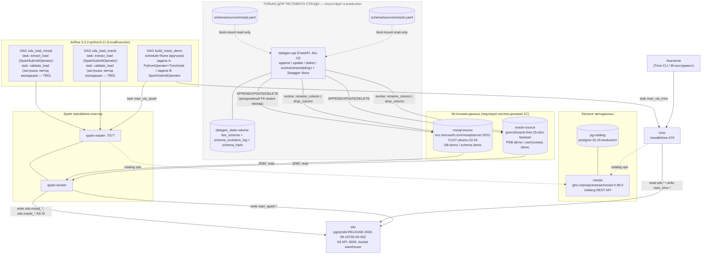

# datalake_stand — PoC стенда КХД → DLH

Локальный docker-compose стенд: загрузка данных из реальных реляционных
источников (MSSQL, Oracle) в ODS-слой Iceberg **AS IS**, и демонстрация
двух способов трансформации данных внутри DataLake (Trino SQL и Spark).

## Архитектура



## Состав стенда

**Контур A (релевантно production DLH-архитектуре):**

| Компонент           | Образ/версия                                                                                     |
| ------------------- | ------------------------------------------------------------------------------------------------ |
| mssql-source        | `mcr.microsoft.com/mssql/server:2022-CU27-ubuntu-22.04`                                          |
| oracle-source       | `gvenzl/oracle-free:23-slim-faststart`                                                           |
| pg-catalog          | `postgres:16.15-bookworm`                                                                        |
| nessie              | `ghcr.io/projectnessie/nessie:0.99.0`                                                           |
| silo                | `pgsty/silo:RELEASE.2026-09-16T00-00-00Z`                                                        |
| spark-master/worker | база `tabulario/spark-iceberg:3.5.5_1.8.1` + `mssql-jdbc:12.10.0.jre11` + `ojdbc11:23.8.0.25.04` |
| trino               | `trinodb/trino:479`                                                                              |
| airflow             | `apache/airflow:3.3.2-python3.11`, LocalExecutor                                                 |

<br />

**Контур B (только тестовый стенд, нет в production):** `datagen-api` —
REST API для наполнения источников синтетическими данными и ограниченной
эволюции их схемы (`rename_column`/`drop_column`). Схема источников
зафиксирована в `schema/sources/mssql.yaml` / `schema/sources/oracle.yaml`.

## Быстрый старт

```bash
docker compose up -d --build
```

Порты:

| Сервис                       | Порт на хосте |
| ---------------------------- | ------------- |
| mssql-source                 | 1433          |
| oracle-source                | 1521          |
| datagen-api                  | 8090          |
| nessie                       | 19120         |
| silo (S3 API / консоль)      | 9000 / 9001   |
| spark-master UI              | 8080          |
| spark-worker UI              | 8081          |
| trino (HTTPS)                | 8443          |
| airflow webserver/api-server | 8089          |

## Доступ к сервисам

### Web-интерфейсы

| Сервис | URL | Логин/пароль |
|---|---|---|
| Spark Master UI | http://localhost:8080 | без авторизации |
| Spark Worker UI | http://localhost:8081 | без авторизации |
| SILO (консоль, MinIO-совместимая) | http://localhost:9001 | `admin` / `admin123` (`SILO_ROOT_USER`/`SILO_ROOT_PASSWORD`) |
| sydafa (Swagger UI) | http://localhost:8090/docs | без авторизации (эмулятор источников СУБД) |
| Airflow | http://localhost:8089 | `admin` / `admin` (`AIRFLOW_UI_USER`/`AIRFLOW_UI_PASSWORD`) |

### Подключение из DBeaver (на машине, где запущен docker)

DBeaver подключается к `localhost` — порты опубликованы в `docker-compose.yaml`
(см. таблицу портов выше).

**Trino** — драйвер «Trino» (встроен в DBeaver):
- Host: `localhost`, Port: `8443`
- Use SSL: да (Trino работает по HTTPS с самоподписанным сертификатом)
- Catalog/Database: `iceberg`
- Username: `admin`, Password: `admin`
  (включена авторизация файловым password-authenticator'ом — см. `trino/etc/`)
- На вкладке Driver properties отключить проверку сертификата:
  `SSL=true;SSLVerification=NONE` (самоподписанный сертификат контейнера)
- JDBC URL целиком: `jdbc:trino://localhost:8443/iceberg?SSL=true&SSLVerification=NONE`

**mssql-source** — драйвер «SQL Server» (Microsoft):
- Host: `localhost`, Port: `1433`
- Database: `sydafa`
- Authentication: SQL Server Authentication
- Username: `reader`, Password: `reader` (только чтение; для полного доступа — `sydafa` / `sydafa`)
- На вкладке Driver properties (или прямо в URL): `encrypt=false;trustServerCertificate=true`.

**oracle-source** — драйвер «Oracle»:
- Host: `localhost`, Port: `1521`
- Connection type: Service Name, значение `sydafa`
- Username: `reader`, Password: `reader` (только чтение; для полного доступа — `sydafa` / `sydafa`)

## Работа со стендом

### Управление источниками и данными — sydafa

Сервис **sydafa** вынесен в отдельный репозиторий [georgekochergin/sydafa](https://github.com/georgekochergin/sydafa) и поставляется в виде независимого Docker-образа (`sydafa:latest` или `ghcr.io/georgekochergin/sydafa:latest`).
В рамках стенда `datalake_stand` конфигурация источников монтируется из локальной директории `config/sydafa/sources/` (`mssql.yaml`, `oracle.yaml`).

REST-интерфейс: `http://localhost:8090`, Swagger UI — `http://localhost:8090/docs`.
Сервис `sydafa` эмулирует источники данных: запускает контейнеры СУБД, создаёт рабочую базу `sydafa`, пользователя `reader/reader` и предоставляет API для управления схемами и генерацией данных.

Таблицы и схемы данных **не хранятся на хосте в виде файлов**. Создание схем, таблиц и миграции выполняются через транзакционный эндпоинт `POST /sources/{source}/schema/evolve`.

| Метод | Путь | Назначение | Тело запроса |
| --- | --- | --- | --- |
| GET | `/health` | статус готовности сервиса | — |
| GET | `/sources` | список источников | — |
| GET | `/sources/{source}` | реквизиты, параметры reader и список таблиц | — |
| GET | `/sources/{source}/schema` | текущая live-схема источника (JSON) | — |
| GET | `/tables/{source}/{schema}/{table}` | схема таблицы | — |
| POST | `/sources/{source}/schema/evolve` | транзакционная эволюция (All-or-Nothing) | `{"operations": [...]}` |
| POST | `/tables/{source}/{schema}/{table}/append` | вставить N строк (FK-каскад) | `{"rows": N, "new_key_ratio": r}` |
| POST | `/tables/{source}/{schema}/{table}/update` | обновить строки по предикату | `{"predicate": [...], "set": {...}}` |
| POST | `/tables/{source}/{schema}/{table}/delete` | удалить строки по предикату | `{"predicate": [...], "cascade": bool}` |

---

### Спецификация API эволюции схемы (POST /sources/{source}/schema/evolve)

Эндпоинт принимает JSON-документ со списком упорядоченных операций. Все операции выполняются строго по очереди в рамках **одной транзакции СУБД**. При ошибке на любом шаге выполняется полный `ROLLBACK` (All-or-Nothing) и возвращается HTTP 422.

#### Доступные операции (`op`):
1. **`create_schema`**: создание схемы (MSSQL schema / Oracle user).
   `{"op": "create_schema", "name": "demo"}`
2. **`create_table`**: создание таблицы со спецификацией колонок, PK и FK.
   ```json
   {
     "op": "create_table",
     "schema": "demo",
     "name": "customers",
     "primary_key": ["customer_id"],
     "columns": [
       {"name": "customer_id", "type": "bigint", "generator": {"kind": "sequence"}},
       {"name": "name", "type": "string", "generator": {"kind": "faker", "provider": "company"}},
       {"name": "segment", "type": "string", "generator": {"kind": "choice", "values": ["Retail", "Corporate", "VIP"]}}
     ],
     "foreign_keys": []
   }
   ```
3. **`rename_table`**: переименование таблицы.
   `{"op": "rename_table", "schema": "demo", "from_name": "customers", "to_name": "clients"}`
4. **`drop_table`**: удаление таблицы.
   `{"op": "drop_table", "schema": "demo", "name": "customers"}`
5. **`add_column`**: добавление колонки в таблицу.
   `{"op": "add_column", "schema": "demo", "table": "customers", "column": {"name": "discount", "type": "decimal(5,2)"}}`
6. **`rename_column`**: переименование колонки.
   `{"op": "rename_column", "schema": "demo", "table": "customers", "from_name": "discount", "to_name": "special_discount"}`
7. **`drop_column`**: удаление колонки.
   `{"op": "drop_column", "schema": "demo", "table": "customers", "name": "discount"}`
8. **`transfer_table`**: перенос таблицы между схемами.
   `{"op": "transfer_table", "table": "clients", "from_schema": "demo", "to_schema": "core"}`
9. **`rename_schema`**: переименование схемы с переносом её таблиц.
   `{"op": "rename_schema", "from_name": "demo", "to_name": "core"}`
10. **`drop_schema`**: удаление пустой схемы.
    `{"op": "drop_schema", "name": "core"}`

---

### Семантика объявления колонок и генераторов данных (`generator`)

Каждая колонка таблицы описывается объектом:
- `name`: имя колонки (латиница, цифры, подчёркивание);
- `type`: логический тип данных (`bigint`, `string`, `date`, `timestamp`, `decimal(p,s)`);
- `generator`: конфигурация генератора синтетических данных (объект с полем `kind`):
  - **`sequence`** (`{"kind": "sequence"}`): автоинкрементный числовой генератор для первичных ключей (`MAX(pk) + 1`).
  - **`faker`** (`{"kind": "faker", "provider": "company"}`): вызов провайдера библиотеки Faker. Поддерживаются: `company`, `name`, `word`, `address`, `email`.
  - **`choice`** (`{"kind": "choice", "values": ["Retail", "VIP"]}`): выбор случайного значения из списка `values`.
  - **`random_decimal`** (`{"kind": "random_decimal", "min": 1, "max": 1000}`): случайное число с 2 знаками после запятой.
  - **`random_date`** (`{"kind": "random_date"}`): случайная дата за последние 365 дней.
  - **`null`** (`null`): для колонок внешних ключей (FK), заполняемых автоматически из родительской таблицы при генерации.

---

### Манипуляция данными (DML API)

#### POST .../append — добавить строки
Тело `{"rows": N, "new_key_ratio": r}`:
- `rows`: количество строк (1..100000);
- `new_key_ratio`: вероятность (0..1) создания новой родительской строки по внешнему ключу (FK). При 0 переиспользуются существующие ключи.

#### POST .../update — обновить строки по предикату
Тело `{"predicate": [{"column": "...", "operator": "...", "value": ...}], "set": {"col": "val"}}`:
- Операторы предиката: `=`, `!=`, `<`, `<=`, `>`, `>=`.
- Все условия объединяются через `AND` с безопасной bind-параметризацией.
- Ответ: `{"updated": N}`.

#### POST .../delete — удалить строки по предикату
Тело `{"predicate": [{"column": "...", "operator": "...", "value": ...}], "cascade": bool}`:
- При `cascade: false` удаление отклоняется с `409 Conflict`, если на строку ссылаются дочерние записи.
- При `cascade: true` каскадно удаляются зависимые строки во всех дочерних таблицах.
- Ответ: `{"deleted": N}`.
- `source`=`mssql`, `schema`=`demo`, `table`=`products`, `{"ddl_operation": "drop_column", "column_name": "price", "apply_to": "both"}`.

### Обновление ODS-слоя Iceberg

Отдельные DAG-и в Airflow (расписание `schedule=None` — запуск вручную):

- `ods_load_mssql` → `spark/jobs/load_ods_mssql.py`: читает `demo.demo.*` из mssql-source и перезаписывает (AS IS) `iceberg.ods.mssql_customers`, `mssql_orders`, `mssql_products`;
- `ods_load_oracle` → `spark/jobs/load_ods_oracle.py`: читает `demo.*` из oracle-source и перезаписывает (AS IS) `iceberg.ods.oracle_customers`, `oracle_orders`, `oracle_products`.

Запуск — Airflow UI → DAGs → ▶, либо CLI:

```bash
docker compose exec -T airflow-scheduler airflow dags trigger ods_load_mssql
docker compose exec -T airflow-scheduler airflow dags trigger ods_load_oracle
```

Проверка результата (Trino): `SELECT count(*) FROM iceberg.ods.mssql_orders;`

### Обновление детального (mart) слоя

DAG `build_marts_demo` (вручную, `schedule=None`) — две независимые задачи:

- `mart_via_trino` → `trino/sql/build_mart_trino_demo.sql`: создаёт `iceberg.mart_trino.customer_totals` (`customer_id`, `orders_count`, `total_amount`) из `iceberg.ods.mssql_orders`;
- `mart_via_spark` → `spark/jobs/build_mart_spark_demo.py`: создаёт `iceberg.mart_spark.customer_totals` (`customer_id`, `orders_count`, `total_amount`) из `iceberg.ods.mssql_orders`.

Запуск:

```bash
docker compose exec -T airflow-scheduler airflow dags trigger build_marts_demo
```

Результат — таблицы `iceberg.mart_trino.customer_totals` и `iceberg.mart_spark.customer_totals` (читаются из Trino).

## Полное тестирование стенда

Полный флоу работы стенда проверяется автономным тестом: он поднимает стек,
прогоняет все этапы в контейнере и в конце полностью гасит сборку.

Запуск (из корня репозитория):

```bash
./scripts/full-test.sh
```

Скрипт делает:
1. `docker compose down -v --remove-orphans` — чистит прежние контейнеры и volume-ы (прежние данные не влияют на запуск);
2. `docker compose up -d --build` — собирает и поднимает весь стек;
3. `docker compose run --rm test-runner` — в отдельном контейнере прогоняет тест:
   - проверяет готовность Nessie / datagen-api / Trino / Airflow / Spark;
   - наполняет таблицы `customers`, `products`, `orders` в `mssql` и `oracle`, обновляет и удаляет часть строк;
   - corner-case: удаление FK-родителя без `cascade` (409), `drop_column` PK/FK (422), неизвестная колонка/оператор и SQL-инъекция (422);
   - запускает DAG-и `ods_load_mssql`, `ods_load_oracle` и сверяет таблицы `iceberg.ods.*` через Trino;
   - запускает DAG `build_marts_demo` и проверяет витрины `iceberg.mart_trino.customer_totals` и `iceberg.mart_spark.customer_totals`;
   - печатает сводку `PASS=n FAIL=m`;
4. `docker compose down -v --remove-orphans` — в любом исходе гасит сборку: удаляет контейнеры, сети и volume-ы (`pg_catalog_data`, `airflow_pg_data`, `silo_data`, `datagen_state`).

Результат: финальная строка `PASS=… FAIL=…`; exit-code 0 — всё прошло, при
FAIL — смотреть `.agents/skills/datalake-stand-verify/references/troubleshooting.md`.
После прогона стенд погашен, данные удалены; образы остаются в локальном кеше.

Предусловия: Docker + Docker Compose, склонированный репозиторий, `.env`
(уже закоммичен). Интернет нужен только для первого `build` образов — повторные
запуски работают офлайн.

Для разработки (стенд остаётся поднятым) — обычный `docker compose up -d --build`.

## Учётные данные

Тестовый стенд — везде, где логин/пароль настраиваемы, используется
`admin` / `admin` (см. `.env`). Исключение по имени — системный
bootstrap-логин MSSQL `sa`: имя фиксировано образом, а пароль не может быть
буквально `admin` (MSSQL требует длину ≥8 и минимум 3 из 4 категорий символов),
поэтому у `sa` остаётся сильный пароль `AdminPassword1!`, а для доступа извне
`datagen-api` автоматически создаёт логин `admin`/`admin` с ролью sysadmin.
SILO (консоль `:9001`) — `admin`/`admin123` (MinIO требует пароль ≥8 символов,
поэтому буквально `admin` невозможен), pg-catalog, airflow-postgres,
Airflow UI (`:8089`), Trino (`:8443`) — везде `admin`/`admin`. У Oracle системные SYS/SYSTEM и
прикладной пользователь-схема `demo` (бизнес-схема данных, имя сознательно
оставлено `demo`) — пароль `admin`.

## Транзакционная эволюция схем через API sydafa

В отличие от устаревших подходов с хранением файлов схем на хосте, в `sydafa`:
- База данных при старте всегда чистая.
- Все схемы и таблицы создаются и модифицируются через вызов API `POST /sources/{source}/schema/evolve`.
- Любая эволюция атомарна (All-or-Nothing): либо все операции из пакета применяются, либо ни одна.
- Данные при переименованиях таблиц и колонок сохраняются в полном объёме.
