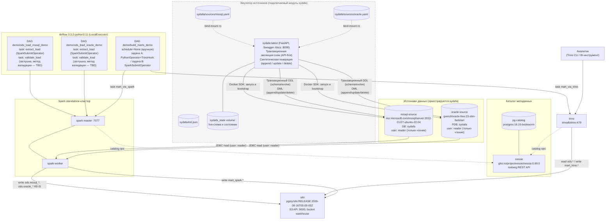

# datalake_stand — PoC стенда КХД → DLH

Локальный docker-compose стенд: загрузка данных из реальных реляционных
источников (MSSQL, Oracle) в ODS-слой Iceberg **AS IS**, и демонстрация
двух способов трансформации данных внутри DataLake (Trino SQL и Spark).

## Архитектура



## Состав стенда

**Контур A (релевантно production DLH-архитектуре):**

| Компонент           | Образ/версия                                                                                     |
| ------------------- | ------------------------------------------------------------------------------------------------ |
| mssql-source        | `mcr.microsoft.com/mssql/server:2022-CU27-ubuntu-22.04`                                          |
| oracle-source       | `gvenzl/oracle-free:23-slim-faststart`                                                           |
| pg-catalog          | `postgres:16.15-bookworm`                                                                        |
| nessie              | `ghcr.io/projectnessie/nessie:0.99.0`                                                           |
| silo                | `pgsty/silo:RELEASE.2026-09-16T00-00-00Z`                                                        |
| spark-master/worker | база `tabulario/spark-iceberg:3.5.5_1.8.1` + `mssql-jdbc:12.10.0.jre11` + `ojdbc11:23.8.0.25.04` |
| trino               | `trinodb/trino:479`                                                                              |
| airflow             | `apache/airflow:3.3.2-python3.11`, LocalExecutor                                                 |

<br />

**Контур B (эмуляция источников данных, подключаемый компонент):** `sydafa` —
автономный сервис (Docker-образ `sydafa:latest`), оркестрирующий контейнеры СУБД,
предоставляющий REST API для транзакционной эволюции схем и FK-aware генерации синтетических данных.
Конфигурация источников стенда: `sydafa/sources/mssql.yaml` / `oracle.yaml` и файл начальной структуры `sydafa/init.json`.

## Быстрый старт

```bash
docker compose up -d --build
```

Порты:

| Сервис                       | Порт на хосте |
| ---------------------------- | ------------- |
| mssql-source                 | 1433          |
| oracle-source                | 1521          |
| sydafa (Swagger UI :8090)    | 8090          |
| nessie                       | 19120         |
| silo (S3 API / консоль)      | 9000 / 9001   |
| spark-master UI              | 8080          |
| spark-worker UI              | 8081          |
| trino (HTTPS)                | 8443          |
| airflow webserver/api-server | 8089          |

## Доступ к сервисам

### Web-интерфейсы

| Сервис | URL | Логин/пароль |
|---|---|---|
| Spark Master UI | http://localhost:8080 | без авторизации |
| Spark Worker UI | http://localhost:8081 | без авторизации |
| SILO (консоль, MinIO-совместимая) | http://localhost:9001 | `admin` / `admin123` (`SILO_ROOT_USER`/`SILO_ROOT_PASSWORD`) |
| sydafa (Swagger UI) | http://localhost:8090/docs | без авторизации (эмулятор источников СУБД) |
| Airflow | http://localhost:8089 | `admin` / `admin` (`AIRFLOW_UI_USER`/`AIRFLOW_UI_PASSWORD`) |

### Подключение из DBeaver (на машине, где запущен docker)

DBeaver подключается к `localhost` — порты опубликованы в `docker-compose.yaml`
(см. таблицу портов выше).

**Trino** — драйвер «Trino» (встроен в DBeaver):
- Host: `localhost`, Port: `8443`
- Use SSL: да (Trino работает по HTTPS с самоподписанным сертификатом)
- Catalog/Database: `iceberg`
- Username: `admin`, Password: `admin`
  (включена авторизация файловым password-authenticator'ом — см. `trino/etc/`)
- На вкладке Driver properties отключить проверку сертификата:
  `SSL=true;SSLVerification=NONE` (самоподписанный сертификат контейнера)
- JDBC URL целиком: `jdbc:trino://localhost:8443/iceberg?SSL=true&SSLVerification=NONE`

**mssql-source** — драйвер «SQL Server» (Microsoft):
- Host: `localhost`, Port: `1433`
- Database: `sydafa`
- Authentication: SQL Server Authentication
- Username: `reader`, Password: `reader` (только чтение; для полного доступа — `sydafa` / `sydafa`)
- На вкладке Driver properties (или прямо в URL): `encrypt=false;trustServerCertificate=true`.

**oracle-source** — драйвер «Oracle»:
- Host: `localhost`, Port: `1521`
- Connection type: Service Name, значение `sydafa`
- Username: `reader`, Password: `reader` (только чтение; для полного доступа — `sydafa` / `sydafa`)

## Работа со стендом

### Управление источниками и данными — sydafa

Сервис **sydafa** (Synthetic Data Factory & DB Orchestrator) вынесен в отдельный независимый репозиторий [georgekochergin/sydafa](https://github.com/georgekochergin/sydafa) и поставляется в виде Docker-образа (`ghcr.io/georgekochergin/sydafa:latest` или локальный `sydafa:latest`).

На данном стенде `sydafa` эмулирует реляционные источники данных:
- Автоматически оркестрирует контейнеры СУБД `mssql-source` и `oracle-source` через Docker API;
- Создаёт рабочую базу/PDB `sydafa` и пользователя-инспектора `reader` / `reader` с доступом строго на чтение;
- Предоставляет REST API для транзакционной эволюции схем данных (API-first) и синтетической генерации данных с соблюдением целостности внешних ключей.

Конфигурации источников стенда расположены в директории: `sydafa/sources/` (`mssql.yaml`, `oracle.yaml`), а исходная схема таблиц задается через `sydafa/init.json`.

REST-интерфейс: `http://localhost:8090`, интерактивная документация: `http://localhost:8090/docs`.

#### Основные эндпоинты

| Метод | Путь | Назначение |
| --- | --- | --- |
| GET | `/health` | Проверка готовности источников (200 OK) |
| GET | `/sources` | Список зарегистрированных источников |
| GET | `/sources/{source}` | Метаданные источника, статус reader и список таблиц |
| GET | `/sources/{source}/schema` | Текущая live-схема источника (JSON) |
| GET | `/tables/{source}/{schema}/{table}` | Схема конкретной таблицы |
| POST | `/sources/{source}/schema/evolve` | Транзакционная эволюция схем (All-or-Nothing rollback) |
| POST | `/tables/{source}/{schema}/{table}/append` | Генерация и вставка строк с соблюдением связей (FK) |
| POST | `/tables/{source}/{schema}/{table}/update` | Параметризованное обновление строк по предикату |
| POST | `/tables/{source}/{schema}/{table}/delete` | Удаление строк по предикату (с контролем связей FK) |

#### Документация и спецификация API sydafa

Вся детальная документация, правила интеграции и спецификации вынесены в репозиторий проекта:
- 📖 [Руководство по интеграции sydafa в другие проекты](https://github.com/georgekochergin/sydafa#интеграция-в-сторонние-проекты) (docker-compose, сеть, volumes, healthcheck);
- 🔄 [Спецификация API эволюции схемы (10 операций миграций)](https://github.com/georgekochergin/sydafa#транзакционная-эволюция-схем-post-sourcessourceschemaevolve);
- 🧬 [Семантика колонок и генераторов данных (`sequence`, `faker`, `choice`, `random_decimal`, `random_date`)](https://github.com/georgekochergin/sydafa#семантика-колонок-и-генераторов-данных-generator);
- 💾 [Спецификация DML API (`append`, `update`, `delete`)](https://github.com/georgekochergin/sydafa#манипуляция-данными-dml-api).

---

### Обновление ODS-слоя Iceberg

Отдельные DAG-и в Airflow (расписание `schedule=None` — запуск вручную):

- `ods_load_mssql_demo` → `spark/jobs/load_ods_mssql.py`: читает `demo.*` из mssql-source и перезаписывает (AS IS) `iceberg.ods.mssql_customers`, `mssql_orders`, `mssql_products`;
- `ods_load_oracle_demo` → `spark/jobs/load_ods_oracle.py`: читает `demo.*` из oracle-source и перезаписывает (AS IS) `iceberg.ods.oracle_customers`, `oracle_orders`, `oracle_products`.

Демо-DAG-и изолированы в подкаталоге `airflow/dags/demo/` и создаются в выключенном состоянии (`is_paused_upon_creation=True`). Запуск — Airflow UI → DAGs → unpause & ▶, либо CLI:

```bash
docker compose exec -T airflow-scheduler airflow dags unpause ods_load_mssql_demo
docker compose exec -T airflow-scheduler airflow dags trigger ods_load_mssql_demo
docker compose exec -T airflow-scheduler airflow dags unpause ods_load_oracle_demo
docker compose exec -T airflow-scheduler airflow dags trigger ods_load_oracle_demo
```

Проверка результата (Trino): `SELECT count(*) FROM iceberg.ods.mssql_orders;`

### Обновление детального (mart) слоя

DAG `build_marts_demo` (вручную, `schedule=None`) — две независимые задачи:

- `mart_via_trino` → `trino/sql/build_mart_trino_demo.sql`: создаёт `iceberg.mart_trino.customer_totals` (`customer_id`, `orders_count`, `total_amount`) из `iceberg.ods.mssql_orders`;
- `mart_via_spark` → `spark/jobs/build_mart_spark_demo.py`: создаёт `iceberg.mart_spark.customer_totals` (`customer_id`, `orders_count`, `total_amount`) из `iceberg.ods.mssql_orders`.

Запуск:

```bash
docker compose exec -T airflow-scheduler airflow dags trigger build_marts_demo
```

Результат — таблицы `iceberg.mart_trino.customer_totals` и `iceberg.mart_spark.customer_totals` (читаются из Trino).

## Полное тестирование стенда

Полный флоу работы стенда проверяется автономным тестом: он поднимает стек,
прогоняет все этапы в контейнере и в конце полностью гасит сборку.

Запуск (из корня репозитория):

```bash
./scripts/full-test.sh
```

Скрипт делает:
1. `docker compose down -v --remove-orphans` — чистит прежние контейнеры и volume-ы (прежние данные не влияют на запуск);
2. `docker compose up -d --build` — собирает и поднимает весь стек;
3. `docker compose run --rm test-runner` — в отдельном контейнере прогоняет тест:
   - проверяет готовность Nessie / sydafa / Trino / Airflow / Spark;
   - получает метаданные таблиц через API sydafa (`GET /sources/{source}`);
   - очищает таблицы источников (`truncate`) через единый `POST /sources/{source}/exec`;
   - наполняет таблицы `customers`, `products`, `orders` через единый `POST /sources/{source}/exec` (`append`);
   - активирует (unpause) и запускает демо-DAG-и `ods_load_mssql_demo`, `ods_load_oracle_demo`, сверяя выгрузку в `iceberg.ods.*` через Trino;
   - активирует и запускает витринный DAG `build_marts_demo`, проверяя витрины `iceberg.mart_trino.customer_totals` и `iceberg.mart_spark.customer_totals`;
   - печатает сводку `PASS=n FAIL=m`;
4. `docker compose down -v --remove-orphans` — в любом исходе гасит сборку: удаляет контейнеры, сети и volume-ы (`pg_catalog_data`, `airflow_pg_data`, `silo_data`, `sydafa_state`).

Результат: финальная строка `PASS=… FAIL=…`; exit-code 0 — всё прошло, при
FAIL — смотреть `docs/troubleshooting.md`.
После прогона стенд погашен, данные удалены; образы остаются в локальном кеше.

Предусловия: Docker + Docker Compose, склонированный репозиторий, `.env`
(уже закоммичен). Интернет нужен только для первого `build` образов — повторные
запуски работают офлайн.

Для разработки (стенд остаётся поднятым) — обычный `docker compose up -d --build`.

## Учётные данные

Тестовый стенд — везде, где логин/пароль настраиваемы, используется
`admin` / `admin` (см. `.env`). Исключение по имени — системный
bootstrap-логин MSSQL `sa`: имя фиксировано образом, а пароль не может быть
буквально `admin` (MSSQL требует длину ≥8 и минимум 3 из 4 категорий символов),
поэтому у `sa` остаётся сильный пароль `AdminPassword1!`, а для доступа извне
`sydafa` автоматически создаёт логин `sydafa`/`sydafa` с ролью sysadmin (а для чтения — `reader`/`reader`).
SILO (консоль `:9001`) — `admin`/`admin123` (MinIO требует пароль ≥8 символов,
поэтому буквально `admin` невозможен), pg-catalog, airflow-postgres,
Airflow UI (`:8089`), Trino (`:8443`) — везде `admin`/`admin`. У Oracle системные SYS/SYSTEM и
технический суперпользователь `sydafa` — пароль `sydafa`, читатель — `reader` / `reader`.
